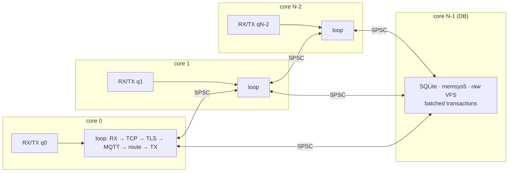
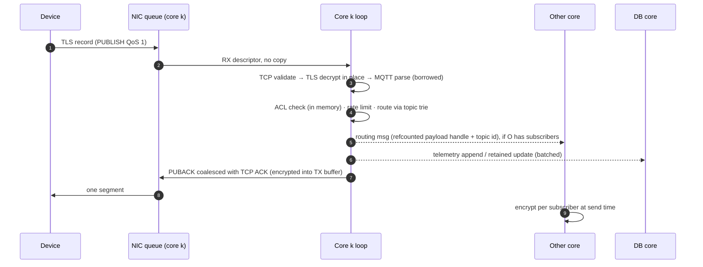

<div align="center">

# urMQTT

**An ARM64 unikernel that *is* an MQTT broker.**
Kernel, TCP/IP, TLS 1.3, MQTT and an embedded database in one Rust binary, booted from one ISO.

[](https://github.com/zeljan-alduk/urMQTT/actions/workflows/ci.yml)
[](https://github.com/zeljan-alduk/urMQTT/actions/workflows/codeql.yml)
[](https://github.com/zeljan-alduk/urMQTT/actions/workflows/fuzz.yml)
[](https://scorecard.dev/viewer/?uri=github.com/zeljan-alduk/urMQTT)
[](#license)

-red)

</div>

> [!WARNING]
> **urMQTT is pre-alpha and does not serve MQTT yet.** Milestone **M0** (workspace, configuration
> system, tooling, CI) is complete. The kernel boots from **M1** on, and MQTT over TLS arrives in
> **M10**. Every feature and example below is tagged with the milestone that delivers it, and
> [docs/PROGRESS.md](docs/PROGRESS.md) is the source of truth for what works.

---

## Contents

- [Why urMQTT](#why-urmqtt)
- [Features](#features)
- [Architecture](#architecture)
- [Repository layout](#repository-layout)
- [Getting started](#getting-started)
- [Configuration](#configuration)
- [Usage examples](#usage-examples)
- [Deployment](#deployment)
- [Development](#development)
- [CI/CD](#cicd)
- [Roadmap](#roadmap)
- [Contributing, security, license](#contributing)

---

## Why urMQTT

An IoT fleet mostly needs one thing from its server: hold millions of mostly idle, long-lived
connections, authenticate every device, and move small messages reliably. A typical broker
deployment puts Linux, OpenSSL, a language runtime, SSH, a package manager and a broker on top
of each other, and every layer adds attack surface, memory and moving parts.

urMQTT removes all of the layers except the broker:

| | Typical broker on Linux | urMQTT |
|---|---|---|
| Exposed services | SSH, broker, often a metrics/admin port | **TCP 8883 only** (MQTT over TLS 1.3 + mTLS) |
| Code in the image | Kernel, userland, libc, OpenSSL, runtime | **One Rust ELF** (+ vendored SQLite) |
| Remote management | Shell, config files, package updates | **None.** A new version is a new ISO |
| Memory per idle connection | Kilobytes (socket buffers, TLS objects, heap) | **Target ≤ 512 B** |
| Multicore model | Threads and locks, or one event loop | **Thread-per-core, shared-nothing, run-to-completion** |
| Code integrity | Writable/executable mappings possible | **W^X, locked page tables, PAC/BTI** |

Priorities, in order: **security → scale → multicore performance → small footprint → immutable deployment.**

## Features

Legend: ✅ done · 🚧 in progress · 📋 planned (milestone)

| Area | Feature | Status |
|---|---|---|
| **Build** | Reproducible workspace, pinned toolchain, `--locked` everywhere | ✅ M0 |
| | Build-time configuration, validated, compiled to constants | ✅ M0 |
| | Bootable UEFI ISO (Limine) for aarch64 | 📋 M1 |
| | Bit-for-bit reproducible, signed images; raw disk image | 📋 M17 |
| **Kernel** | EL1 exception vectors with decoded ESR/ELR/FAR reports | 📋 M1 |
| | Own page tables with W^X, guard pages, PAC/BTI when present | 📋 M2 |
| | GICv3, generic timer, monotonic clock | 📋 M3 |
| | SMP bring-up, per-CPU data (`TPIDR_EL1`), SGI IPIs | 📋 M4 |
| | Hardware discovery via **DTB and ACPI** (MADT, GTDT, MCFG, SPCR) | 📋 M5 |
| **Devices** | PL011 UART, Limine framebuffer text log | 📋 M1 |
| | PCIe ECAM, virtio-pci modern: net, blk, rng | 📋 M6 |
| | virtio-net multiqueue + RSS, fallback software dispatcher | 📋 M13 |
| **Network** | DHCPv4, ARP, ICMP echo (smoltcp prototype) | 📋 M7 |
| | Own server-only TCP: SYN cookies, timing wheel, NewReno, ACK coalescing | 📋 M14 |
| | IPv6 + SLAAC | 📋 later |
| **TLS** | TLS 1.3 only, **mutual TLS**, device id from CN or SAN URI | 📋 M10 |
| | rustls handshake, then own record layer (AES-128-GCM, ChaCha20-Poly1305) | 📋 M10 |
| | Session resumption (PSK tickets), handshake admission control | 📋 M10 |
| **MQTT** | Zero-copy 3.1.1 codec, fuzzed, `forbid(unsafe_code)` | 📋 M8 |
| | QoS 0/1, wildcards, retained, LWT, persistent sessions, keepalive | 📋 M9 |
| | ACL (`devices/{id}/#` by default), per-device rate limits | 📋 M9 |
| | MQTT 5.0, QoS 2 | 📋 later |
| **Storage** | SQLite in the kernel over a raw virtio-blk VFS (WAL, exclusive) | 📋 M11 |
| | Device registry, revocations, retained messages, sessions | 📋 M11 |
| | Per-core append-only telemetry log with CRC and crash recovery | 📋 M12 |
| **Scale** | Per-core event loops, slabs, buffer pools, cross-core fan-out | 📋 M13 |
| | ≤ 512 B per idle TLS connection, measured at 10k/100k/1M | 📋 M15 |
| **Ops** | Watchdog, rate limits, UDP syslog/statsd to a private collector | 📋 M16 |

## Architecture

The full design is in [docs/ARCHITECTURE.md](docs/ARCHITECTURE.md) and the decisions behind it
are in [docs/DECISIONS.md](docs/DECISIONS.md). The overview:

### Layers


### Execution model: thread-per-core, shared-nothing

Every CPU runs its own loop with its own NIC queue pair, TCP table, TLS states, sessions, topic
trie, timer wheel, allocators and log segment. Cores share no mutable state, only bounded
lock-free **SPSC rings**, one per ordered pair of cores. The highest-numbered core runs SQLite and
nothing else.



- **Run to completion.** A received packet is processed fully on one core, from TCP through TLS decrypt-in-place, MQTT parse and routing to the encrypted reply, with no task queues and no copies into application buffers.
- **Adaptive polling.** Under load the RX queues are busy-polled. When idle the core falls back to interrupts and `WFI`. Interrupt handlers only acknowledge and mark work.
- **Watchdog.** A 10 ms per-core tick catches handlers that overrun their budget.

### The life of a PUBLISH



### Memory per connection

The target is **≤ 512 B per idle TLS connection** (stretch goal ~256 B). The design never keeps a
per-connection buffer while a connection is idle: buffers are pooled and attached only while a
frame or record is incomplete or data is unacknowledged. The budget below is the plan M15 measures
against:

| Part | Budget |
|---|---:|
| TCP control block (32-bit indices, packed flags, wheel slots) | 64–96 B |
| TLS 1.3 record state (keys, IVs, sequence numbers; zeroized key slab) | ≤ 128 B |
| MQTT session, hot form (interned ids) | ≤ 64 B |
| Subscriptions (1–2 × 32-bit topic-node ids) | ~16 B |
| Connection-table slot + timer entries | ~48 B |
| **Total** | **~300–400 B** |

### Security model

- **One port.** TCP 8883: TLS 1.3 only, client certificates required, signed by the CA compiled into the image. The MQTT client id must equal the certificate's device id.
- **No ways in.** No shell, console input, SSH, admin API, dynamic code, network-reachable SQL or filesystem.
- **Memory safety.** Rust, with `forbid(unsafe_code)` in the protocol crates, every `unsafe` block justified with a `// SAFETY:` comment (lint-enforced), and no panics on external input (clippy denies `unwrap`, `expect`, indexing and `panic!` in data-path crates).
- **Exploit mitigation.** W^X, page tables locked after boot, guard pages, PAC/BTI when the CPU supports them.
- **Abuse resistance.** SYN cookies, per-core handshake admission control, per-device rate limits, bounded queues, and a TCP window tied to broker backpressure.
- **Immutable.** Configuration, CA and server key are baked into the image, and changing anything means a new image.

The threat model is in [docs/SECURITY.md](docs/SECURITY.md).

### Persistence

The data lives on a separate virtio-blk disk with no filesystem:

```
[ superblock: magic · layout version · uuid · region table · CRC ]
[ SQLite main DB ][ SQLite WAL ][ telemetry log core 0 ][ core 1 ] … [ core N ]
```

- **SQLite** is compiled into the kernel, with a raw-disk VFS, WAL mode and `locking_mode=EXCLUSIVE`. It holds the device registry, revocations, retained messages and persistent sessions.
- **Telemetry** goes to per-core append-only segments with a CRC per record. On boot, recovery truncates a torn tail.

## Repository layout

```
urMQTT/
├── PROMPT.md               full specification and milestone plan (source of truth)
├── Makefile                every entry point (make help)
├── rust-toolchain.toml     pinned nightly (ADR-002)
├── crates/
│   ├── kernel/             the binary: boot, core loop, wiring
│   ├── arch-aarch64/       vectors, MMU, GICv3, timer, PSCI, PAC/BTI, RNDR
│   ├── platform/           DTB + ACPI discovery
│   ├── mm/                 frames, heap, slabs, pools
│   ├── pci/  virtio/       PCIe ECAM + MSI-X, virtio net/blk/rng
│   ├── log/                per-CPU log rings and sinks
│   ├── net/  tcp/          IPv4 stack, server-only TCP
│   ├── tls/                TLS 1.3 (rustls handshake + record layer)
│   ├── mqtt/  broker/      codec and broker core
│   ├── timer-wheel/        hierarchical timing wheel
│   ├── store/              SQLite FFI, VFS, telemetry log
│   ├── config/             no_std typed build-time configuration
│   └── config-schema/      TOML schema, validation, codegen (host)
├── deploy/{dev,prod}/      config.toml per environment (certificates are never committed)
├── scripts/                gen-dev-certs.sh, later mkiso.sh, run-qemu.sh, smoke.sh
├── fuzz/                   cargo-fuzz targets
├── tools/loadgen/          host-side MQTT/TLS load generator
├── vendor/                 pinned Limine and SQLite, with checksums
└── docs/                   ARCHITECTURE, DECISIONS (ADRs), PROGRESS, DEPLOY, SECURITY
```

## Getting started

### Prerequisites

**macOS on Apple Silicon** (the primary dev platform):

```bash
# Rust (https://rustup.rs). The pinned toolchain installs itself from rust-toolchain.toml.
curl --proto '=https' --tlsv1.2 -sSf https://sh.rustup.rs | sh

brew install qemu xorriso llvm mosquitto openssl
cargo install cargo-fuzz --locked      # optional, for make fuzz
```

**Linux (aarch64 or x86_64 host)**:

```bash
sudo apt install qemu-system-arm qemu-efi-aarch64 xorriso clang lld mosquitto-clients openssl
```

### Build and check

These steps work today:

```bash
git clone https://github.com/zeljan-alduk/urMQTT.git
cd urMQTT
rustup toolchain install     # installs nightly-2026-10-20 + rust-src, clippy, rustfmt, llvm-tools
make certs                   # dev CA, server cert, 3 device certs, negative-test certs
make check                   # fmt + clippy (host and aarch64-unknown-none) + host tests
make build                   # target/aarch64-unknown-none/release/urmqtt
```

`make help` lists every target.

### Boot it (from M1)

```bash
make iso ENV=dev             # build/urmqtt-dev-<version>.iso
make data-img                # build/data.img (blank, sparse, 1 GiB)
make run                     # QEMU + HVF, 4 vCPU, 512 MB, serial on stdio
```

Expected serial output:

```text
URMQTT BOOT 0.1.0 cpu=4 mem=512
...
URMQTT READY
```

## Configuration

Everything is configured **at build time** in `deploy/<env>/config.toml` and compiled into the image.
`crates/config-schema` validates it: unknown keys, wrong types, out-of-range values, malformed
topic patterns and misplaced files all **fail the build** with every error listed at once:

```text
$ make build ENV=bad
error: invalid configuration deploy/bad/config.toml:
  - network.mqtt_plain_port: plaintext MQTT is only allowed in ["dev"], set it to 0
  - limits.max_inflight_qos1: must be greater than 0
```

### Reference

| Key | Type / values | Meaning |
|---|---|---|
| `network.mode` | `"dhcp"` \| `"static"` | Address configuration. DHCP lets one ISO serve many VMs |
| `network.address`, `network.gateway` | `"a.b.c.d/len"`, `"a.b.c.d"` | Required for `static`, forbidden for `dhcp` |
| `network.mqtt_tls_port` | 1–65535 | MQTT over TLS listener (8883) |
| `network.mqtt_plain_port` | 0 or port | Plaintext MQTT; **non-zero only in `dev`** |
| `tls.ca`, `tls.cert`, `tls.key` | file names in `deploy/<env>/` | Embedded PEMs; encrypted keys are rejected |
| `tls.identity_field` | `"cn"` \| `"san_uri"` | Certificate field that becomes the `device_id` |
| `tls.resumption` | bool | TLS 1.3 PSK session resumption |
| `limits.max_connections_per_core` | > 0 | Admission limit per core |
| `limits.max_packet_size` | 64 – 268 435 455 | Largest accepted MQTT packet |
| `limits.max_topic_len`, `max_topic_levels` | ≤ 65 535, > 0 | Topic bounds, checked before any allocation |
| `limits.max_subscriptions_per_session` | > 0 | |
| `limits.max_inflight_qos1` | > 0 | Unacknowledged QoS 1 per session |
| `limits.max_queued_per_offline_session` | ≥ 0 | Bounded offline queue |
| `limits.publish_rate_per_device` | `"N/s"`, `"N/m"`, `"N/h"` | Token bucket per device |
| `limits.handshakes_per_core_per_sec` | > 0 | Handshake admission control (reconnect storms) |
| `acl.device_publish`, `acl.device_subscribe` | topic filters, `{id}` = device id | Default device rights |
| `storage.sqlite_heap_mb` | 1–4096 | Fixed SQLite `memsys5` heap |
| `storage.telemetry_topics` | topic filters | PUBLISHes appended to the telemetry log |
| `storage.retention_days` | > 0 | Telemetry retention |
| `storage.require_flush` | bool | Refuse disks without `VIRTIO_BLK_F_FLUSH` |
| `observability.log_level` | `error`…`trace` | |
| `observability.syslog_udp`, `metrics_udp` | `""` or `"a.b.c.d:port"` | Private syslog and statsd collectors |
| `watchdog.handler_budget_ms` | 1–10 000 | Per-handler time budget |
| `watchdog.action` | `log` \| `drop` \| `reset` | What happens on overrun (ADR-013) |

### Configuration examples

**Static address on a private network**

```toml
[network]
mode = "static"
address = "10.0.0.10/24"
gateway = "10.0.0.1"
mqtt_tls_port = 8883
mqtt_plain_port = 0
```

**Identity from a SAN URI, with a shared fleet topic.** Certificates generated by
`gen-dev-certs.sh` carry `URI:urn:urmqtt:device:<id>`.

```toml
[tls]
identity_field = "san_uri"

[acl]
device_publish   = ["devices/{id}/#"]
device_subscribe = ["devices/{id}/cmd/#", "fleet/broadcast/#"]
```

**Telemetry capture with metrics to a private collector**

```toml
[storage]
telemetry_topics = ["devices/+/telemetry/#", "devices/+/events/alarm"]
retention_days = 90

[observability]
log_level = "info"
syslog_udp = "10.0.0.5:514"
metrics_udp = "10.0.0.5:8125"
```

**A new environment.** Create `deploy/staging/config.toml`, add its certificates, then:

```bash
make build ENV=staging
make iso ENV=staging        # from M1
```

## Usage examples

The examples use the dev certificates from `make certs`, the QEMU port forwards from `make run`
(`localhost:8883` and, in dev, `localhost:1883`) and the default ACL. Each example names the
milestone from which it works.

### 1. A device publishes telemetry over mTLS (M10)

```bash
mosquitto_pub -h localhost -p 8883 \
  --cafile deploy/dev/ca.pem \
  --cert deploy/dev/devices/device-001.pem --key deploy/dev/devices/device-001.key \
  -i device-001 -q 1 \
  -t devices/device-001/telemetry/temperature -m '{"c":21.5,"ts":1761696000}'
```

The client id `-i device-001` must equal the certificate CN (or SAN URI, depending on
`tls.identity_field`).

### 2. A device listens for commands (M10)

```bash
mosquitto_sub -h localhost -p 8883 \
  --cafile deploy/dev/ca.pem \
  --cert deploy/dev/devices/device-002.pem --key deploy/dev/devices/device-002.key \
  -i device-002 -q 1 -c -v \
  -t 'devices/device-002/cmd/#'
```

`-c` (no clean session) makes the session persistent, so QoS 1 commands sent while the device is
offline are queued (up to `max_queued_per_offline_session`) and delivered on reconnect.

> [!NOTE]
> Under the default ACL, devices cannot talk to each other: a device may only subscribe to its own
> `devices/{id}/cmd/#`. Commands come from a **backend service identity** with wider rights, using a
> separate certificate profile. Service identities are planned for M10 and are not yet part of the
> configuration schema.

### 3. A device reports its status with a retained message and Last Will (M10)

```bash
mosquitto_sub -h localhost -p 8883 \
  --cafile deploy/dev/ca.pem \
  --cert deploy/dev/devices/device-003.pem --key deploy/dev/devices/device-003.key \
  -i device-003 -k 30 -q 1 \
  --will-topic devices/device-003/status --will-payload offline --will-retain --will-qos 1 \
  -t 'devices/device-003/cmd/#' &

mosquitto_pub -h localhost -p 8883 \
  --cafile deploy/dev/ca.pem \
  --cert deploy/dev/devices/device-003.pem --key deploy/dev/devices/device-003.key \
  -i device-003 -r -q 1 -t devices/device-003/status -m online
```

If the device vanishes (the process is killed, or the network drops for longer than 1.5 × keepalive),
the broker publishes the retained `offline` will on its behalf.

### 4. Rejections are the feature (M10)

```bash
# Unknown CA → TLS handshake fails
mosquitto_pub -h localhost -p 8883 --cafile deploy/dev/ca.pem \
  --cert deploy/dev/negative/rogue-device.pem --key deploy/dev/negative/rogue-device.key \
  -i device-001 -t devices/device-001/x -m hi

# Expired certificate → TLS handshake fails
mosquitto_pub -h localhost -p 8883 --cafile deploy/dev/ca.pem \
  --cert deploy/dev/negative/expired-device.pem --key deploy/dev/negative/expired-device.key \
  -i device-002 -t devices/device-002/x -m hi

# Client id ≠ certificate identity → CONNACK "not authorized"
mosquitto_pub -h localhost -p 8883 --cafile deploy/dev/ca.pem \
  --cert deploy/dev/devices/device-001.pem --key deploy/dev/devices/device-001.key \
  -i device-002 -t devices/device-002/x -m hi

# Outside the ACL → publish dropped / subscription refused
mosquitto_pub -h localhost -p 8883 --cafile deploy/dev/ca.pem \
  --cert deploy/dev/devices/device-001.pem --key deploy/dev/devices/device-001.key \
  -i device-001 -t devices/device-002/cmd/reboot -m pwned
```

### 5. Plain TCP in dev builds only (M9)

Before TLS lands, and only in `ENV=dev` with `mqtt_plain_port = 1883`, the broker takes the dev
identity from the client id:

```bash
# -d prints the protocol exchange: CONNECT/CONNACK, PUBLISH (QoS 1)/PUBACK
mosquitto_pub -h localhost -p 1883 -d -q 1 -i device-001 -t devices/device-001/telemetry/t -m 42

# Holds a persistent session on the device's own command topic
mosquitto_sub -h localhost -p 1883 -c -q 1 -v -i device-002 -t 'devices/device-002/cmd/#'
```

A prod build with a non-zero `mqtt_plain_port` does not compile.

### 6. Running on more cores, with TCG, or under a debugger (M1–M4)

```bash
make run-smp N=8             # one "core N online" line per vCPU, IPI ping-pong test
make run-tcg                 # TCG instead of HVF (CI, or features HVF lacks)
make debug                   # QEMU halted with -s -S; then in another terminal:
lldb target/aarch64-unknown-none/release/urmqtt -o 'gdb-remote localhost:1234'
```

### 7. Inspecting network traffic (M6+)

```bash
# scripts/run-qemu.sh adds a filter-dump when PCAP is set
make run PCAP=build/net.pcap
tshark -r build/net.pcap -Y 'arp || tcp.port == 8883'
```

### 8. Load testing (M13)

```bash
make loadtest ARGS="--connections 50000 --rate 2000/s --keepalive 60 --publish 1/30s"
```

QEMU user networking (slirp) tops out far below a million connections. For ≥ 100k use
`vmnet-shared` on macOS (needs sudo) or a Linux host with KVM, tap and several client IPs.

### 9. Fuzzing (works today)

```bash
make fuzz T=config_parse FUZZ_TIME=60     # every parser gets a target as it lands
cargo fuzz list                            # config_parse (M0); mqtt_decode (M8); tcp, tls, dtb, acpi later
```

## Deployment

An image is the entire deployment: the code, configuration, CA and server key are all inside it.
Persistent data lives on a separate virtio-blk disk, so upgrading means booting a new image
against the same data disk.

| Target | Path | Status |
|---|---|---|
| QEMU (macOS HVF / Linux KVM / TCG) | `make run`, `make run-tcg` | 📋 M1 |
| Generic KVM / Proxmox (aarch64) | UEFI VM, ISO or raw image, virtio-net/blk/rng | 📋 M17 |
| Hetzner Cloud CAX (Ampere) | raw image via rescue system and snapshot | 📋 M17 |
| Oracle Cloud Always Free (Ampere A1) | custom image import, paravirtualized (virtio) | 📋 after M5 + M17 |

Platforms that expose only non-virtio devices (AWS ENA/NVMe, Azure MANA) are not supported.
Details are in [docs/DEPLOY.md](docs/DEPLOY.md).

```bash
# Production build: put your own ca.pem, server.pem and server.key in deploy/prod/ (never commit them)
make iso ENV=prod
shasum -a 256 build/urmqtt-prod-*.iso
```

> [!CAUTION]
> A prod image embeds your server private key, so treat the ISO itself as a secret. The images
> attached to GitHub releases are **dev** builds with throwaway keys, for evaluation only.

## Development

| Command | What it does |
|---|---|
| `make check` | `cargo fmt --check`, `clippy -D warnings` on host **and** `aarch64-unknown-none`, host tests |
| `make build` | Release kernel ELF (fat LTO, `codegen-units=1`, `panic=abort`) |
| `make iso ENV=…` | Bootable UEFI ISO (M1) |
| `make run` / `run-tcg` / `run-smp N=8` / `debug` | QEMU variants (M1, M4) |
| `make smoke` | Headless boot, wait for `URMQTT READY`, run client checks, power off (M1+) |
| `make data-img` | Blank sparse data disk (layout initialised from M11) |
| `make fuzz T=<target>` | Bounded cargo-fuzz run (`FUZZ_TIME`, default 600 s) |
| `make loadtest` | Host-side load generator (M10/M13) |
| `make dist` | Release artifacts plus `SHA256SUMS` in `build/dist/` |
| `make certs` | Development certificates (idempotent; `scripts/gen-dev-certs.sh --force` regenerates) |

Ground rules (details in [CONTRIBUTING.md](CONTRIBUTING.md)):

- no panics on external input,
- `unsafe` only in the hardware and FFI crates, each block with a `// SAFETY:` comment,
- no allocation in the hot path,
- a comment on every atomic ordering,
- every limit comes from configuration,
- intentional stubs fail loudly.

The work proceeds milestone by milestone. Each milestone ends with `make check` and `make smoke`
green, a `M<n>: …` commit, a [PROGRESS](docs/PROGRESS.md) entry, and an
[ADR](docs/DECISIONS.md) for every non-obvious decision.

## CI/CD

| Workflow | Trigger | What it does |
|---|---|---|
| [`ci.yml`](.github/workflows/ci.yml) | push, PR, merge queue | fmt, clippy (host + bare metal), typos, actionlint, shellcheck · host tests on **Linux arm64 and macOS arm64** · kernel build for `dev` and `prod` configs, with the ELF size in the job summary · cargo-deny (advisories, licenses, bans, sources) · 60 s fuzz smoke per target |
| [`fuzz.yml`](.github/workflows/fuzz.yml) | nightly, manual | 10 minutes per fuzz target, corpus cached between runs, crashes uploaded |
| [`codeql.yml`](.github/workflows/codeql.yml) | push, PR, weekly | CodeQL for Rust and GitHub Actions |
| [`scorecard.yml`](.github/workflows/scorecard.yml) | push, weekly | OpenSSF Scorecard supply-chain report |
| [`release.yml`](.github/workflows/release.yml) | tag `v*` | builds artifacts, `SHA256SUMS`, **SLSA build provenance**, GitHub Release |
| [Dependabot](.github/dependabot.yml) | weekly | grouped cargo and Actions updates |

Every third-party action is pinned to a full commit SHA, and workflows run with read-only
permissions unless a job needs more. QEMU smoke tests join CI in M1 and run under TCG on the arm64
runners.

Verify a release artifact:

```bash
gh attestation verify urmqtt-dev-v0.1.0.elf --repo zeljan-alduk/urMQTT
shasum -a 256 -c SHA256SUMS
```

## Roadmap

| | Milestone | Acceptance |
|---|---|---|
| ✅ | **M0** Workspace & tooling | `make check` green on macOS |
| 📋 | **M1** Boot | Limine ISO boots under HVF and TCG; a test fault prints a decoded exception |
| 📋 | **M2** Memory | W^X verified by deliberate faults; PAC/BTI detection logged |
| 📋 | **M3** Interrupts & time | GICv3, periodic tick, IRQ latency measured |
| 📋 | **M4** SMP | `run-smp N=8`, IPI ping-pong between all core pairs |
| 📋 | **M5** Platform discovery | `acpi=on` and `acpi=off` give identical summaries |
| 📋 | **M6** PCIe & virtio | blk write/flush/read-back; gratuitous ARP in a pcap |
| 📋 | **M7** Network prototype | DHCP lease, ping, TCP echo through hostfwd |
| 📋 | **M8** MQTT codec | spec tests, property tests, 10 minutes of fuzzing with no crash |
| 📋 | **M9** Broker over TCP (dev) | pub/sub, wildcards, retained, LWT, QoS 1 redelivery with mosquitto |
| 📋 | **M10** TLS 1.3 + mTLS | mosquitto over mTLS; wrong CA, expired, client-id mismatch and revoked all rejected |
| 📋 | **M11** SQLite in the kernel | data survives restarts and `kill -9` |
| 📋 | **M12** Telemetry log | 1M messages; torn tail truncated on recovery |
| 📋 | **M13** Multicore data plane | near-linear scaling 1 → 2 → 4 cores |
| 📋 | **M14** Own TCP stack | smoltcp replaced; loss simulation tests; segment fuzzing |
| 📋 | **M15** Memory per connection | measured bytes per idle TLS connection ≤ 512 B |
| 📋 | **M16** Hardening & ops | threat model; a 100k-client reconnect storm survives |
| 📋 | **M17** Deployment | bit-identical ISO rebuilds, signatures, cloud guides |

Later: MQTT 5.0, QoS 2, IPv6, cold-session compression, SQLite isolation at EL0, an export bridge,
and ACPI-only validation on real ARM clouds.

## Contributing

Contributions are welcome. Start with [CONTRIBUTING.md](CONTRIBUTING.md) and the
[specification](PROMPT.md). By participating you agree to the [code of conduct](CODE_OF_CONDUCT.md).

**Security:** please report vulnerabilities privately, see [SECURITY.md](SECURITY.md).

## License

Dual-licensed under either of

- Apache License, Version 2.0 ([LICENSE-APACHE](LICENSE-APACHE))
- MIT license ([LICENSE-MIT](LICENSE-MIT))

at your option. Vendored components keep their own licenses (Limine: BSD-2-Clause, SQLite: public domain).
