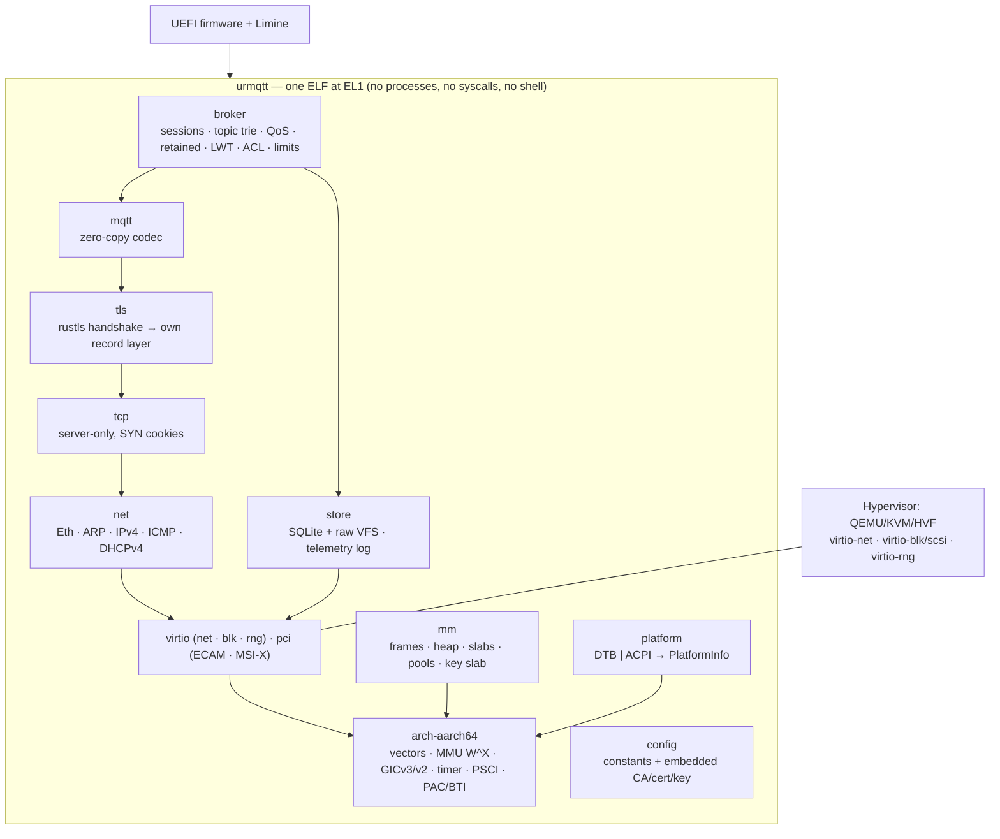
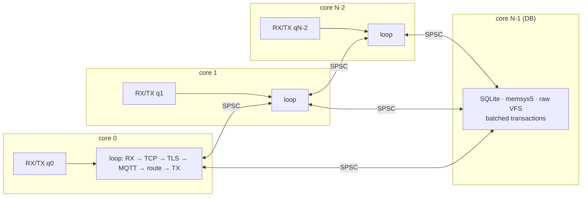
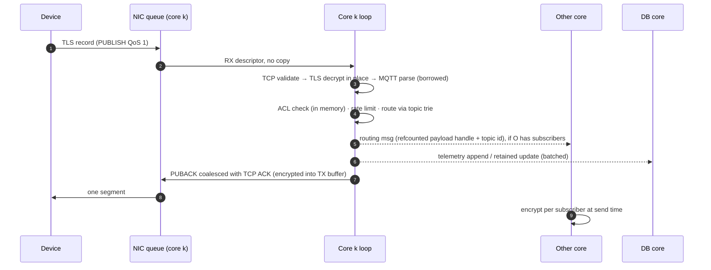

<div align="center">

# urMQTT

**An ARM64 unikernel that *is* an MQTT broker.**
Kernel, TCP/IP, TLS 1.3, MQTT and an embedded database in one Rust binary, booted from one ISO.

[](https://github.com/zeljan-alduk/urMQTT/actions/workflows/ci.yml)
[](https://github.com/zeljan-alduk/urMQTT/actions/workflows/codeql.yml)
[](https://github.com/zeljan-alduk/urMQTT/actions/workflows/fuzz.yml)
[](https://scorecard.dev/viewer/?uri=github.com/zeljan-alduk/urMQTT)
[](#license)

-red)

</div>

> [!WARNING]
> **urMQTT is pre-alpha.** It serves MQTT 3.1.1 over TLS 1.3 with mutual TLS (and, in dev builds
> only, over plain TCP), and keeps its state in SQLite on a raw data disk. These milestones are complete:
> - **M0**: tooling and CI
> - **M1**: UEFI boot, console, exception reports
> - **M2**: own page tables with enforced W^X, guard pages, locked tables, PAC and BTI
> - **M3**: GICv3 (GICv2 added later, for Raspberry Pi KVM hosts), generic timer, periodic tick with measured IRQ latency
> - **M4**: SMP bring-up on up to 64 cores, with IPIs checked between every pair of cores
> - **M5**: hardware discovery from DTB or ACPI into one description, with identical results from both
> - **M6**: PCIe and virtio drivers (rng, blk, net), MSI-X, and a CSPRNG seeded from hardware entropy
> - **M7**: DHCP, ICMP and a TCP echo service on smoltcp
> - **M8**: complete MQTT 3.1.1 codec, fuzzed and tested against real mosquitto clients
> - **M9**: broker core with QoS 0/1, wildcards, retained messages, LWT, persistent sessions and ACL, verified with mosquitto clients
> - **M10**: TLS 1.3 with mutual TLS: rustls handshake, own crypto provider and record layer, revocation list, resumption, admission control
> - **M11**: SQLite inside the kernel on a raw-disk VFS (WAL, exclusive), with a DB core fed by SPSC rings. State survives restarts and `kill -9`
> - **M12**: per-core telemetry log with CRC per record, batched writes, crash recovery and torn-tail truncation, verified with a million records
> - **M13**: multicore data plane: per-core stacks and broker shards, Toeplitz dispatcher, relayed sessions, cross-core fan-out, per-CPU heap caches; linear scaling to 4 worker cores in-guest
> - **M14**: own server-only TCP/IP stack (SYN cookies, timing wheel, NewReno, ACK coalescing) and DHCP client; smoltcp removed
> - **M15**: 494 B per idle mTLS connection at 10k (heap blocks, allocator rounding included): compact state, per-record TLS key derivation, device-scoped subscriptions without per-device trie nodes
> - **M16**: admission that survives reconnect storms (free-heap reserve, in-flight limits per core and per source address, DB backpressure), handler watchdog, health check, rate-limited logs, syslog (RFC 5424) and statsd over UDP, 11 fuzz targets in CI, threat model
> - **M17**: bit-identical rebuilds (checked in CI), raw GPT disk image next to the ISO, minisign signatures, dev-only code out of production images, deployment guide for KVM/Proxmox and Hetzner
>
> The kernel boots under QEMU with HVF and TCG. Every feature and example below is tagged with the milestone that delivers it, and
> [docs/PROGRESS.md](docs/PROGRESS.md) is the source of truth for what works.

> [!NOTE]
> **Where this is going** ([roadmap](#next-one-multi-platform-iso-raw-disk-demonstrably-secure), planned, not yet built):
> - **One multi-platform ISO** that boots on aarch64 and x86_64, by UEFI or legacy BIOS, in VMs and on bare-metal hardware.
> - **No filesystem:** the data stays on a raw disk with its own minimal, specified layout.
> - **Security work aimed at an external audit.**

---

## Contents

- [Why urMQTT](#why-urmqtt)
- [Features](#features)
- [Architecture](#architecture)
- [Repository layout](#repository-layout)
- [Getting started](#getting-started)
- [Configuration](#configuration)
- [Usage examples](#usage-examples)
- [Deployment](#deployment)
- [Development](#development)
- [CI/CD](#cicd)
- [Roadmap](#roadmap)
- [Contributing, security, license](#contributing)

---

## Why urMQTT

An IoT fleet mostly needs one thing from its server: hold millions of mostly idle, long-lived
connections, authenticate every device, and move small messages reliably. A typical broker
deployment puts Linux, OpenSSL, a language runtime, SSH, a package manager and a broker on top
of each other, and every layer adds attack surface, memory and moving parts.

urMQTT removes all of the layers except the broker:

| | Typical broker on Linux | urMQTT |
|---|---|---|
| Exposed services | SSH, broker, often a metrics/admin port | **TCP 8883 only** (MQTT over TLS 1.3 + mTLS) |
| Code in the image | Kernel, userland, libc, OpenSSL, runtime | **One Rust ELF** (+ vendored SQLite) |
| Remote management | Shell, config files, package updates | **None.** A new version is a new ISO |
| Memory per idle connection | Kilobytes (socket buffers, TLS objects, heap) | **Target ≤ 512 B** |
| Multicore model | Threads and locks, or one event loop | **Thread-per-core, shared-nothing, run-to-completion** |
| Code integrity | Writable/executable mappings possible | **W^X, locked page tables, PAC/BTI** |

Priorities, in order: **security → scale → multicore performance → small footprint → immutable deployment.**

## Features

Legend: ✅ done · 🚧 in progress · 📋 planned (milestone)

| Area | Feature | Status |
|---|---|---|
| **Build** | Reproducible workspace, pinned toolchain, `--locked` everywhere | ✅ M0 |
| | Build-time configuration, validated, compiled to constants | ✅ M0 |
| | Bootable UEFI ISO (Limine) for aarch64 | ✅ M1 |
| | Bit-for-bit reproducible (checked in CI), minisign-signed images; ISO and raw GPT disk image | ✅ M17 |
| **Kernel** | EL1 exception vectors with decoded ESR/ELR/FAR reports | ✅ M1 |
| | Own page tables with W^X, guard pages, PAC/BTI when present | ✅ M2 |
| | GICv3, generic timer, monotonic clock | ✅ M3 |
| | GICv2 (KVM on GIC-400 hosts: Raspberry Pi 4/5), up to 8 CPUs | ✅ after M17 (TCG-tested) |
| | SMP bring-up, per-CPU data (`TPIDR_EL1`), SGI IPIs | ✅ M4 |
| | Hardware discovery via **DTB and ACPI** (MADT, GTDT, MCFG, SPCR) | ✅ M5 |
| **Devices** | PL011 UART, Limine framebuffer text log | ✅ M1 |
| | PCIe ECAM, virtio-pci modern: net, blk, rng | ✅ M6 |
| | Software dispatcher (Toeplitz/RSS hash) on one virtio-net queue pair | ✅ M13 |
| | virtio-net multiqueue + RSS | 📋 later (needs tap/vhost to test) |
| **Network** | Own DHCPv4 client, ARP, ICMP echo, strict IPv4 (no options, no fragments) | ✅ M14 |
| | Own server-only TCP: SYN cookies, timing wheel, NewReno, ACK coalescing, no TIME_WAIT | ✅ M14 |
| | IPv6 + SLAAC | 📋 later |
| **TLS** | TLS 1.3 only, **mutual TLS**, device id from CN or SAN URI | ✅ M10 |
| | rustls handshake, then own record layer (AES-128-GCM, ChaCha20-Poly1305, KeyUpdate) | ✅ M10 |
| | Session resumption (PSK tickets), handshake admission control, revocation list | ✅ M10 |
| **MQTT** | Zero-copy 3.1.1 codec, fuzzed, `forbid(unsafe_code)` | ✅ M8 |
| | QoS 0/1, wildcards, retained, LWT, persistent sessions, keepalive | ✅ M9 |
| | ACL (`devices/{id}/#` by default), service identities, per-device rate limits | ✅ M9 |
| | MQTT 5.0, QoS 2 | 📋 later |
| **Storage** | SQLite in the kernel over a raw-disk VFS (WAL, exclusive), quick_check at boot | ✅ M11 |
| | Data disk on virtio-blk or a virtio-scsi LUN (as clouds attach disks) | ✅ after M17 |
| | Device registry, revocations, retained messages, persistent sessions with offline queues | ✅ M11 |
| | Per-core append-only telemetry log with CRC and crash recovery | ✅ M12 |
| **Scale** | Per-core event loops and broker shards, per-CPU heap caches, frame pools, cross-core fan-out | ✅ M13 |
| | ≤ 512 B per idle TLS connection (494 B measured at 10k), no per-device trie nodes | ✅ M15 |
| **Ops** | Handler watchdog (log / drop / reset), health check, rate-limited logs | ✅ M16 |
| | Syslog (RFC 5424) and statsd metrics over UDP to private collectors | ✅ M16 |
| | Admission that survives reconnect storms: free-heap reserve, in-flight limits per core and per source address | ✅ M16 |

## Architecture

The full design is in [docs/ARCHITECTURE.md](docs/ARCHITECTURE.md) and the decisions behind it
are in [docs/DECISIONS.md](docs/DECISIONS.md). The overview:

### Layers



### Execution model: thread-per-core, shared-nothing

Every data core runs its own loop with its own TCP stack, TLS states, broker shard (sessions,
topic trie), heap caches and telemetry partition. Cores share no mutable state, only bounded
lock-free **SPSC rings**, one per ordered pair of cores. The highest-numbered core runs SQLite and
nothing else.

Today (M13) the NIC has one queue pair, owned by **core 0**, which steers every MQTT flow by the
Toeplitz (RSS) hash of its 4-tuple to a **worker core** (1 … N-2) and transmits what the workers
send back. A session lives on its **home** worker (`fnv1a(client id)`), so takeover, wills and
persistence never cross cores. A connection that lands on another worker keeps its TCP and TLS
there and relays plaintext MQTT to the home core, with credit-based flow control. Every routed
message is fanned out to the other shards, each of which keeps a replica of the retained messages.



- **Run to completion.** A received packet is processed fully on one core, from TCP through TLS decrypt-in-place, MQTT parse and routing to the encrypted reply, with no task queues and no copies into application buffers.
- **Adaptive polling.** Under load the RX queues are busy-polled. When idle the core falls back to interrupts and `WFI`. Interrupt handlers only acknowledge and mark work.
- **Watchdog.** A 10 ms per-core tick catches handlers that overrun their budget.

### The life of a PUBLISH



### Memory per connection

The target is **≤ 512 B per idle TLS connection** (stretch goal ~256 B). Nothing per connection is
buffered while it is idle: receive data is processed straight from the frame, and send, record and
MQTT buffers exist only while something is incomplete or unacknowledged. The kernel measures it
itself (ADR-034): exact heap counters in requested bytes and in the buddy blocks they occupy, logged
every 10 s as heap above the idle baseline per open connection.

| Part | Size | How |
|---|---:|---|
| TCP control block | 96 B | packed flags, 16-bit RTT/RTO, wheel timer slot, no idle buffers |
| TCP table slot | 4–8 B | connection index only, ≤ half full |
| Connection + TLS 1.3 record state | 152 B | secret + sequence per direction (40 B); key and IV derived per record |
| MQTT connection | 48 B | identity and Will boxed only while present |
| MQTT session, hot form | 64 B | one subscription inline, interned node ids |
| Subscription `devices/<id>/cmd/#` | 0 trie nodes | stored relative to the session's own id, shared by all devices |

**Measured** (HVF, 4 vCPU, 3 worker cores; every device holds an mTLS connection and one QoS 1
subscription; heap blocks including allocator rounding, frame-buffer pool excluded):

| Connections | Bytes per connection |
|---:|---:|
| 960 | 531 B |
| 9 922 | 494 B |
| 10 197 | 474 B |

The frame-buffer pool is a fixed ~2 MiB (≈ 200 B per connection at 10k, ≈ 2 B at 1M). 100k and 1M
connections could not be generated on the development host. QEMU user networking on macOS stopped
accepting at 10 197 connections, about the 10 240-descriptor `OPEN_MAX` of the QEMU process. One
loopback address also has only 16 384 ephemeral ports, and adding addresses needs root. The figure
falls as fixed slab chunks amortize, so it does not grow with the connection count.

### Security model

- **One port.** TCP 8883: TLS 1.3 only, client certificates required, signed by the CA compiled into the image. The MQTT client id must equal the certificate's device id.
- **No ways in.** No shell, console input, SSH, admin API, dynamic code, network-reachable SQL or filesystem.
- **Memory safety.** Rust, with `forbid(unsafe_code)` in the protocol crates, every `unsafe` block justified with a `// SAFETY:` comment (lint-enforced), and no panics on external input (clippy denies `unwrap`, `expect`, indexing and `panic!` in data-path crates).
- **Exploit mitigation.**
  - W^X is enforced by the descriptor encoding and by `SCTLR_EL1.WXN`, and audited on every boot.
  - Page tables are read-only after boot, with no writable alias left.
  - The lower half of the address space is disabled.
  - Every stack has guard pages, and exceptions run on a separate stack.
  - PAC (`pac-ret`) and BTI are enabled when the CPU supports them, and verified by the smoke tests.
- **Abuse resistance.** SYN cookies; admission refuses new connections (before any crypto) on a low heap, a DB core that is behind, too many handshakes in flight per core or per source address, or the handshake rate. Per-device rate limits, bounded queues, a TCP window tied to broker backpressure, rate-limited logs, a handler watchdog and a health check.
- **Immutable.** Configuration, CA and server key are baked into the image, and changing anything means a new image.

The threat model is in [docs/SECURITY.md](docs/SECURITY.md).

### Persistence

The data lives on a separate disk (virtio-blk or virtio-scsi) with no filesystem:

```
LBA 0      [ superblock: magic · layout version · uuid · region table · CRC-32C ]
LBA 8, 16  [ file-size table, slots A/B (newest valid wins) ]
LBA 64     [ SQLite main DB ½ ][ SQLite WAL ⅛ ][ journal 1 MiB ][ telemetry log: 8 partitions … ]
last 4 KiB [ scratch for the boot block-device self-test ]
```

- **SQLite** (vendored 3.54.1, checksum-verified at build time) is compiled into the kernel with clang, freestanding, and uses a fixed `memsys5` heap. Its VFS maps three fixed files onto disk regions; there is no filesystem. It runs in WAL mode with `locking_mode=EXCLUSIVE` (so no shared-memory index) and `synchronous=FULL`, and the boot fails safe on `quick_check` errors. It holds the device registry, revocations, retained messages and persistent sessions with their offline QoS 1 queues.
- **The DB core** (the highest-numbered CPU) runs SQLite and nothing else. The data plane sends it state changes over a lock-free SPSC ring; it batches them into one transaction per 5 ms or 512 operations and reports commits on a second ring. A blank disk is formatted on first boot; anything else is never formatted over.
- **Telemetry**: every accepted PUBLISH on `storage.telemetry_topics` goes to its core's partition of the telemetry log, a ring of segments with a CRC per record (salted with the segment sequence, so old ring passes never reappear). Cores hand records to the DB core over their own SPSC ring without copying. The DB core flushes every 5 ms or 256 KiB. On boot, recovery keeps every flushed record, truncates a torn tail and continues in a fresh segment. Retention is by size (the ring) and by age (`retention_days`).

## Repository layout

```
urMQTT/
├── PROMPT.md               full specification and milestone plan (source of truth)
├── Makefile                every entry point (make help)
├── rust-toolchain.toml     pinned nightly (ADR-002)
├── crates/
│   ├── kernel/             the binary: boot, core loop, wiring
│   ├── arch-aarch64/       vectors, MMU, GICv3/v2, timer, PSCI, PAC/BTI, RNDR
│   ├── platform/           DTB + ACPI discovery
│   ├── mm/                 frames, heap, slabs, pools
│   ├── pci/  virtio/       PCIe ECAM + MSI-X, virtio net/blk/rng
│   ├── log/                per-CPU log rings and sinks
│   ├── net/  tcp/          IPv4 stack, server-only TCP
│   ├── tls/                TLS 1.3 (rustls handshake + record layer)
│   ├── mqtt/  broker/      codec and broker core
│   ├── timer-wheel/        hierarchical timing wheel
│   ├── store/              SQLite FFI, VFS, telemetry log
│   ├── config/             no_std typed build-time configuration
│   └── config-schema/      TOML schema, validation, codegen (host)
├── deploy/{dev,prod}/      config.toml per environment (certificates are never committed)
├── scripts/                gen-dev-certs.sh, later mkiso.sh, run-qemu.sh, smoke.sh
├── fuzz/                   cargo-fuzz targets
├── tools/loadgen/          host-side MQTT/TLS load generator
├── vendor/                 pinned Limine and SQLite, with checksums
└── docs/                   ARCHITECTURE, DECISIONS (ADRs), PROGRESS, DEPLOY, SECURITY
```

## Getting started

### Prerequisites

**macOS on Apple Silicon** (the primary dev platform):

```bash
# Rust (https://rustup.rs). The pinned toolchain installs itself from rust-toolchain.toml.
curl --proto '=https' --tlsv1.2 -sSf https://sh.rustup.rs | sh

brew install qemu xorriso llvm mosquitto openssl@3   # llvm: clang + llvm-ar for SQLite; OpenSSL >= 3
cargo install cargo-fuzz --locked      # optional, for make fuzz
```

**Linux (aarch64 or x86_64 host)**:

```bash
sudo apt install qemu-system-arm qemu-efi-aarch64 xorriso clang llvm mosquitto-clients openssl
```

### Build and check

These steps work today:

```bash
git clone https://github.com/zeljan-alduk/urMQTT.git
cd urMQTT
rustup toolchain install     # installs nightly-2026-10-20 + rust-src, clippy, rustfmt, llvm-tools
make certs                   # dev CA, server cert, 3 device certs, negative-test certs
make check                   # fmt + clippy (host and aarch64-unknown-none) + host tests
make build                   # target/aarch64-unknown-none/release/urmqtt
```

`make help` lists every target.

### Boot it (works today)

```bash
make iso ENV=dev             # build/urmqtt-dev-<version>.iso
make data-img                # build/data.img (blank, sparse, 1 GiB)
make run                     # QEMU + HVF, 4 vCPU, 512 MB, serial on stdio
```

Expected serial output (HVF, 4 vCPU, 512 MB):

```text
URMQTT BOOT 0.0.1 cpu=4 mem=503
[    5.137] INFO  env=dev el=1 bootloader=Limine 12.9.4
[    5.137] INFO  platform: Acpi, uart=0x9000000, psci=Some(Hvc)
[    5.137] INFO  console: pl011 at 0x9000000 mapped at 0xffff800000000000
[    5.138] INFO  psci 1.1 via hvc
[    5.138] INFO  framebuffer: 800x600 text console
...
URMQTT READY
```

Boot also builds the kernel's own address space and audits it before announcing readiness:

```text
[    5.162] INFO  cpu features: pauth=true fpac=true bti=true rndr=false aes=true pmull=true ...
[    5.164] INFO  vm: kernel tables built (45 table pages), 442 MiB free, heap 32 MiB
[    5.164] INFO  vm: switched to kernel tables (TTBR1), lower half disabled, WXN on
[    5.165] INFO  vm: running on kernel stacks (main 128 KiB ...), pac=on bti=on
[    5.166] INFO  vm: page tables locked (2048 KiB read-only, no writable alias)
[    5.167] INFO  selftest: W^X ok (13385 leaf mappings audited, 0 W+X, text-only execute, ...)
[    5.186] INFO  gic: v3 at gicd=0x8000000 gicr=0x80a0000, 1020 lines, msi via GICv2m frame
[    5.423] INFO  timer: irq latency (busy-poll, 25 samples) min=1916 avg=3869 p99<=8192 max=7750 ns
[    5.675] INFO  timer: irq latency (wfi, 25 samples) min=110000 avg=1810114 ... ns
```

With `make run-smp N=8` every core comes online and every pair of cores exchanges an IPI:

```text
[    5.681] INFO  cpu 7 online (mpidr=0x7, el=1)
[    5.682] INFO  smp: 8/8 cpus online (7 application processors started)
[    5.683] INFO  ipi: 56/56 ordered pairs ping-pong ok, round trip avg=11943 ns max=29000 ns
[    5.739] INFO  smp: 8/8 cpus ticking on their own timer
```

Devices are enumerated and tested on every boot:

```text
[    5.185] INFO  pci: ECAM 0x4010000000 buses 0-255, 5 function(s)
[    5.186] INFO  pci 00:03.0 1af4:1001 class 01.00 virtio-blk
[    5.187] INFO  blk: 64 MiB, block size 512, flush=true, read-only=false, msi-x=yes
[    5.188] INFO  net: mac 52:54:00:12:34:56, link up
[    5.189] INFO  entropy: 64 bytes from virtio-rng
[    5.189] INFO  entropy: ChaCha20 CSPRNG seeded
[    5.695] INFO  blk: self-test ok (4 KiB random pattern written, flushed, read back at sector 131064)
[    5.696] INFO  msi-x: 3 blk completion interrupt(s) via GICv2m
[    5.696] INFO  net: gratuitous ARP sent
[    5.696] INFO  net: rx ok, ARP reply from 52:55:0a:00:02:02
```

Under HVF an IRQ reaches a busy-polling core in about 4 µs, while a core asleep in `wfi` wakes
after about 2 ms. That gap is why the data plane busy-polls under load and sleeps only when idle
([ADR-022](docs/DECISIONS.md)).

`make smoke` boots twelve scenarios under HVF and TCG and checks the decoded reports:
- ACPI and device-tree discovery
- data abort, undefined instruction, resumable `brk`, panic
- write to kernel text, executing heap memory
- stack overflow into the guard page, null pointer
- forged return address (PAC), branch to a non-landing pad (BTI)

A data abort report looks like this:

```text
!!! EXCEPTION: synchronous, current EL, SPx
    EC=0x25 data abort (same EL), read, translation fault, level 2 (ISS=0x0000006, IL=1)
    ESR=0x0000000096000006 ELR=0xffffffff8000481c FAR=0xffff80003ffff000 SPSR=0x800003c5
    x0 =0x0000000000000000 x1 =0x000000000000000a ...
!!! fatal exception, stopping
```

## Configuration

Everything is configured **at build time** in `deploy/<env>/config.toml` and compiled into the image.
`crates/config-schema` validates it: unknown keys, wrong types, out-of-range values, malformed
topic patterns and misplaced files all **fail the build** with every error listed at once:

```text
$ make build ENV=bad
error: invalid configuration deploy/bad/config.toml:
  - network.mqtt_plain_port: plaintext MQTT is only allowed in ["dev"], set it to 0
  - limits.max_inflight_qos1: must be greater than 0
```

### Reference

| Key | Type / values | Meaning |
|---|---|---|
| `network.mode` | `"dhcp"` \| `"static"` | Address configuration. DHCP lets one ISO serve many VMs |
| `network.address`, `network.gateway` | `"a.b.c.d/len"`, `"a.b.c.d"` | Required for `static`, forbidden for `dhcp` |
| `network.mqtt_tls_port` | 1–65535 | MQTT over TLS listener (8883) |
| `network.mqtt_plain_port` | 0 or port | Plaintext MQTT; **non-zero only in `dev`** |
| `tls.ca`, `tls.cert`, `tls.key` | file names in `deploy/<env>/` | Embedded PEMs; encrypted keys are rejected |
| `tls.identity_field` | `"cn"` \| `"san_uri"` | Certificate field that becomes the `device_id` |
| `tls.resumption` | bool | TLS 1.3 PSK session resumption |
| `tls.revocation_list` | file name or `""` | Revoked client-certificate serials (hex, one per line) |
| `limits.max_connections_per_core` | > 0 | Admission limit per core |
| `limits.max_packet_size` | 64 – 268 435 455 | Largest accepted MQTT packet |
| `limits.max_topic_len`, `max_topic_levels` | ≤ 65 535, > 0 | Topic bounds, checked before any allocation |
| `limits.max_subscriptions_per_session` | > 0 | |
| `limits.max_inflight_qos1` | > 0 | Unacknowledged QoS 1 per session |
| `limits.max_queued_per_offline_session` | ≥ 0 | Bounded offline queue |
| `limits.publish_rate_per_device` | `"N/s"`, `"N/m"`, `"N/h"` | Token bucket per device |
| `limits.handshakes_per_core_per_sec` | > 0 | Handshake admission control (reconnect storms) |
| `limits.max_handshakes_in_flight_per_core` | > 0 | Concurrent handshakes per core; more are refused |
| `limits.max_handshakes_in_flight_per_ip` | > 0 | Of those, from one source address |
| `acl.device_publish`, `acl.device_subscribe` | topic filters, `{id}` = device id | Default device rights |
| `acl.service_ids` | ids or `prefix*` | Identities with service rights (backends) |
| `acl.service_publish`, `acl.service_subscribe` | topic filters | Service rights |
| `memory.kernel_heap_mb` | power of two, 1–1024 | Kernel heap (buddy allocator); ~500 B per idle connection |
| `memory.min_free_mb` | > 0, < heap | New connections are refused below this much free heap |
| `entropy.fallback` | `jitter` \| `none` | Without virtio-rng and `RNDR`: seed from health-tested CPU jitter, or refuse to boot |
| `storage.sqlite_heap_mb` | 1–4096 | Fixed SQLite `memsys5` heap |
| `storage.telemetry_topics` | topic filters | PUBLISHes appended to the telemetry log |
| `storage.retention_days` | > 0 | Telemetry retention |
| `storage.require_flush` | bool | Refuse disks without `VIRTIO_BLK_F_FLUSH` (false only in `dev`) |
| `storage.require_data_disk` | bool | Refuse to serve without a data disk (false only in `dev`: memory-only) |
| `storage.refuse_on_corruption` | bool | Refuse to serve when `PRAGMA quick_check` fails (false only in `dev`) |
| `observability.log_level` | `error`…`trace` | |
| `observability.syslog_udp`, `metrics_udp` | `""` or `"a.b.c.d:port"` | Private syslog and statsd collectors |
| `watchdog.handler_budget_ms` | 1–10 000 | Per-handler time budget |
| `watchdog.action` | `log` \| `drop` \| `reset` | What happens on overrun (ADR-035); a core stuck for 100 budgets always resets |

### Configuration examples

**Static address on a private network**

```toml
[network]
mode = "static"
address = "10.0.0.10/24"
gateway = "10.0.0.1"
mqtt_tls_port = 8883
mqtt_plain_port = 0
```

**Identity from a SAN URI, with a shared fleet topic.** Certificates generated by
`gen-dev-certs.sh` carry `URI:urn:urmqtt:device:<id>`.

```toml
[tls]
identity_field = "san_uri"

[acl]
device_publish   = ["devices/{id}/#"]
device_subscribe = ["devices/{id}/cmd/#", "fleet/broadcast/#"]
```

**Telemetry capture with metrics to a private collector**

```toml
[storage]
telemetry_topics = ["devices/+/telemetry/#", "devices/+/events/alarm"]
retention_days = 90

[observability]
log_level = "info"
syslog_udp = "10.0.0.5:514"
metrics_udp = "10.0.0.5:8125"
```

**A new environment.** Create `deploy/staging/config.toml`, add its certificates, then:

```bash
make build ENV=staging
make iso ENV=staging        # from M1
```

## Usage examples

The examples use the dev certificates from `make certs`, the QEMU port forwards from `make run`
(`localhost:8883` and, in dev, `localhost:1883`) and the default ACL. Each example names the
milestone from which it works.

### 1. A device publishes telemetry over mTLS (M10)

```bash
mosquitto_pub -h localhost -p 8883 \
  --cafile deploy/dev/ca.pem \
  --cert deploy/dev/devices/device-001.pem --key deploy/dev/devices/device-001.key \
  -i device-001 -q 1 \
  -t devices/device-001/telemetry/temperature -m '{"c":21.5,"ts":1761696000}'
```

The client id `-i device-001` must equal the certificate CN (or SAN URI, depending on
`tls.identity_field`).

### 2. A device listens for commands (M10)

```bash
mosquitto_sub -h localhost -p 8883 \
  --cafile deploy/dev/ca.pem \
  --cert deploy/dev/devices/device-002.pem --key deploy/dev/devices/device-002.key \
  -i device-002 -q 1 -c -v \
  -t 'devices/device-002/cmd/#'
```

`-c` (no clean session) makes the session persistent, so QoS 1 commands sent while the device is
offline are queued (up to `max_queued_per_offline_session`) and delivered on reconnect.

> [!NOTE]
> Under the default ACL, devices cannot talk to each other: a device may only subscribe to its own
> `devices/{id}/cmd/#`. Commands come from a **service identity** such as `backend` (configured in
> `acl.service_ids`, with its own `service_publish` and `service_subscribe` patterns).

### 3. A device reports its status with a retained message and Last Will (M10)

```bash
# announce "online" (retained), then stay connected with an "offline" will
mosquitto_pub -h localhost -p 8883 \
  --cafile deploy/dev/ca.pem \
  --cert deploy/dev/devices/device-003.pem --key deploy/dev/devices/device-003.key \
  -i device-003 -r -q 1 -t devices/device-003/status -m online

mosquitto_sub -h localhost -p 8883 \
  --cafile deploy/dev/ca.pem \
  --cert deploy/dev/devices/device-003.pem --key deploy/dev/devices/device-003.key \
  -i device-003 -k 30 -q 1 \
  --will-topic devices/device-003/status --will-payload offline --will-retain --will-qos 1 \
  -t 'devices/device-003/cmd/#' &
```

Run the two commands one after the other: a second connection with the same client id takes over
the first session, and takeover fires the will.

If the device vanishes (the process is killed, or the network drops for longer than 1.5 × keepalive),
the broker publishes the retained `offline` will on its behalf.

### 4. Rejections are the feature (M10)

```bash
# Unknown CA → TLS handshake fails
mosquitto_pub -h localhost -p 8883 --cafile deploy/dev/ca.pem \
  --cert deploy/dev/negative/rogue-device.pem --key deploy/dev/negative/rogue-device.key \
  -i device-001 -t devices/device-001/x -m hi

# Expired certificate → TLS handshake fails
mosquitto_pub -h localhost -p 8883 --cafile deploy/dev/ca.pem \
  --cert deploy/dev/negative/expired-device.pem --key deploy/dev/negative/expired-device.key \
  -i device-002 -t devices/device-002/x -m hi

# Revoked certificate (serial in deploy/dev/revoked.txt) → TLS handshake fails
mosquitto_pub -h localhost -p 8883 --cafile deploy/dev/ca.pem \
  --cert deploy/dev/negative/revoked-device.pem --key deploy/dev/negative/revoked-device.key \
  -i device-004 -t devices/device-004/x -m hi

# Client id ≠ certificate identity → CONNACK "not authorized"
mosquitto_pub -h localhost -p 8883 --cafile deploy/dev/ca.pem \
  --cert deploy/dev/devices/device-001.pem --key deploy/dev/devices/device-001.key \
  -i device-002 -t devices/device-002/x -m hi

# Outside the ACL → publish dropped / subscription refused
mosquitto_pub -h localhost -p 8883 --cafile deploy/dev/ca.pem \
  --cert deploy/dev/devices/device-001.pem --key deploy/dev/devices/device-001.key \
  -i device-001 -t devices/device-002/cmd/reboot -m pwned
```

The whole TLS acceptance set (the five broker scenarios over mTLS, then the four rejections) runs with:

```bash
make certs iso data-img
scripts/run-qemu.sh --iso build/urmqtt-dev.iso --data build/data.img &
python3 scripts/mqtt-scenarios.py 8883 --tls deploy/dev
```

### 5. Plain TCP in dev builds only (works today)

In `ENV=dev` with `mqtt_plain_port = 1883` the broker takes the identity from the client id.
`backend` is a service identity (`acl.service_ids`), so it can watch every device and send commands:

```bash
make iso data-img
scripts/run-qemu.sh --iso build/urmqtt-dev.iso --data build/data.img --fwd 1883:1883 &

# backend watches all telemetry
mosquitto_sub -h 127.0.0.1 -p 1883 -i backend -q 1 -v -t 'devices/+/telemetry/#' &

# a device publishes; the backend prints "devices/device-001/telemetry/temp 21.5"
mosquitto_pub -h 127.0.0.1 -p 1883 -i device-001 -q 1 -t devices/device-001/telemetry/temp -m 21.5

# a device may not read another device's commands
mosquitto_sub -h 127.0.0.1 -p 1883 -i device-001 -t 'devices/device-002/cmd/#'   # "All subscription requests were denied."

# the whole acceptance set (pub/sub, retained, LWT, QoS 1 after reconnect, ACL):
python3 scripts/mqtt-scenarios.py 1883
```

A prod build with a non-zero `mqtt_plain_port` does not compile.

### 6. Running on more cores, with TCG, or under a debugger (M1–M4)

```bash
make run-smp N=8             # one "core N online" line per vCPU, IPI ping-pong test
make run-tcg                 # TCG instead of HVF (CI, or features HVF lacks)
make debug                   # QEMU halted with -s -S; then in another terminal:
lldb target/aarch64-unknown-none/release/urmqtt -o 'gdb-remote localhost:1234'
```

### 7. Inspecting network traffic (works today)

```bash
make iso data-img
scripts/run-qemu.sh --iso build/urmqtt-dev.iso --data build/data.img --pcap build/net.pcap
tcpdump -nn -r build/net.pcap          # gratuitous ARP + ARP exchange with the slirp gateway
```

### 8. State survives a restart and `kill -9` (M11)

```bash
make certs iso data-img
scripts/run-qemu.sh --iso build/urmqtt-dev.iso --data build/data.img &   # first boot formats the disk
D=deploy/dev
mosquitto_pub -h localhost -p 8883 --cafile $D/ca.pem --cert $D/devices/device-001.pem --key $D/devices/device-001.key \
  -i device-001 -q 1 -r -t devices/device-001/fw -m 2.0.0
mosquitto_sub -h localhost -p 8883 --cafile $D/ca.pem --cert $D/devices/device-002.pem --key $D/devices/device-002.key \
  -i device-002 -c -q 1 -t 'devices/device-002/cmd/#' -E        # persistent session, then offline
mosquitto_pub -h localhost -p 8883 --cafile $D/ca.pem --cert $D/services/backend.pem --key $D/services/backend.key \
  -i backend -q 1 -t devices/device-002/cmd/reboot -m now      # queued for the offline device

pkill -9 qemu-system-aarch64                                     # pull the plug
scripts/run-qemu.sh --iso build/urmqtt-dev.iso --data build/data.img &
# boot log: "db: restored 1 retained message(s), 1 persistent session(s) with 1 queued message(s) ..."
mosquitto_sub -h localhost -p 8883 --cafile $D/ca.pem --cert $D/devices/device-002.pem --key $D/devices/device-002.key \
  -i device-002 -c -q 1 -v -t 'devices/device-002/cmd/#' -C 1    # prints "devices/device-002/cmd/reboot now"
```

The storage self-tests run from the command line of a dev image: `test=db-bench` measures batched
against single-row commits, and `test=db-crash` followed by `test=db-verify` is the kill -9 test
that `make smoke` runs. For the telemetry log, `test=log-crash` (every core but the DB core
writes until the VM is killed) and `test=log-tear` are each followed by `test=log-verify`.

### 9. Load testing and the multicore benchmark (M13)

```bash
# full TLS 1.3 + mTLS + CONNECT churn against a running VM (port forward 18883 -> 8883)
make loadtest ARGS="handshake --port 18883 --threads 32 --duration 10"
# N long-lived connections with PINGREQ, each publishing telemetry every second
make loadtest ARGS="hold --port 18883 --clients 500 --duration 60 --publish-ms 1000"
# both benchmarks on 1, 2 and 4 worker cores, as a Markdown table
make bench
```

`make bench` on an Apple M4 Pro (HVF):

| Worker cores | in-guest handshakes/s | scaling | through QEMU user net (conn/s) |
|---|---|---|---|
| 1 | 862 | 1.00x | 789 |
| 2 | 1 724 | 2.00x | 636 |
| 4 | 3 438 | 3.99x | 536 |

The in-guest number (`test=dp-bench`: client and server inside the VM, each worker on its own)
shows the data plane scaling linearly. The network number is capped by QEMU's single-threaded
user networking, not by the guest (see ADR-032).

QEMU user networking (slirp) tops out far below a million connections (on macOS near 10 240
sockets). For ≥ 100k use `vmnet-shared` on macOS (needs sudo) or a Linux host with KVM, tap and
several client IPs.

Reconnect storms (M16): every round all devices connect at once, retrying refused attempts with
backoff, then all drop without DISCONNECT. `heap_limit_mb=` (dev command line) makes admission treat
the heap as smaller, so a storm larger than the heap can be tested with few sockets:

```bash
make loadtest ARGS="storm --port 18883 --clients 3000 --rounds 3 --threads 8 --retry-s 30 --subscribe 1"
# loadgen: storm round 1: 1368 of 3000 connected in 36.3 s, 5619 attempt(s) refused   (8 MiB limit)
```

Use 4–8 client threads: QEMU's port forward listens with a backlog of one, so many parallel
connectors mostly wait for SYN retransmissions.

### 10. TCP echo through the port forward (dev, works today)

```bash
make iso data-img
scripts/run-qemu.sh --iso build/urmqtt-dev.iso --data build/data.img --fwd 7007:7 &
# wait for "net: dhcp lease 10.0.2.15/24 router 10.0.2.2" on the console, then:
python3 scripts/echo-client.py 7007        # client: echo 1 ok / 3000 ok / 60000 ok
```

### 11. Fuzzing (works today)

```bash
make fuzz T=config_parse FUZZ_TIME=60     # every parser has a target; CI runs each for 60 s
cargo fuzz list                            # 11 targets: config_parse, fdt_parse, acpi_parse, mqtt_decode,
                                           # disk_layout, tcp_segment, net_frame, tls_record, x509_identity,
                                           # broker_input, telemetry_recover
make fuzz T=mqtt_decode FUZZ_TIME=600      # the M8 acceptance run
```

### 12. Syslog and metrics (M16)

The dev configuration sends syslog to `10.0.2.2:5514` and statsd to `10.0.2.2:8125`, which QEMU user
networking delivers to the host's loopback:

```bash
nc -ul 127.0.0.1 5514 &      # RFC 5424, one message per datagram
nc -ul 127.0.0.1 8125 &      # statsd, every 10 s
make run
# <134>1 2026-10-29T07:00:23.158Z 10.0.2.15 urmqtt cpu0 mqtt [meta sysUpTime="560"] mqtt: TLS 1.3 listener on port 8883 ...
# urmqtt.connections:0|g
# urmqtt.heap.used_bytes:1372160|g
# urmqtt.refused.memory:0|c
```

Production images set `observability.syslog_udp` and `metrics_udp` to collectors on a private network.

## Deployment

An image is the entire deployment: the code, configuration, CA and server key are all inside it.
Persistent data lives on a separate disk (virtio-blk or virtio-scsi), so upgrading means booting a new image
against the same data disk.

| Target | Path | Status |
|---|---|---|
| QEMU (macOS HVF / Linux KVM / TCG) | `make run`, `make run-tcg` | ✅ M1 |
| Generic KVM / Proxmox (aarch64) | UEFI VM, raw image (or ISO) + blank data disk, virtio-net/blk/rng | ✅ M17 (raw-disk boot tested in QEMU) |
| Hetzner Cloud CAX (Ampere) | raw image written from the rescue system, Volume as data disk | 📖 documented; virtio-scsi supported, not tried on the real service |
| Oracle Cloud Always Free (Ampere A1) | QCOW2 custom image, paravirtualized | 📖 documented; virtio-scsi supported, not tried on the real service |
| Raspberry Pi 4/5 (4 GB+), any aarch64 Linux KVM host | `scripts/kvm-host/install.sh`: KVM guest with GICv2/v3, systemd service | 📖 documented; GICv2 tested under TCG, not yet on a Pi |

Platforms that expose only non-virtio devices (AWS ENA/NVMe, Azure MANA) are not supported.
Details are in [docs/DEPLOY.md](docs/DEPLOY.md).

```bash
# Production build: put your own ca.pem, server.pem and server.key in deploy/prod/ (never commit them)
make dist ENV=prod       # build/dist/: .elf, .iso, .img (raw GPT disk) + SHA256SUMS
make repro               # rebuild HEAD twice in fresh worktrees: ELF, ISO and raw image must be identical
make sign                # minisign signature over SHA256SUMS (MINISIGN_KEY=... for another key)
```

Releases are signed with the (test) key in [`minisign.pub`](minisign.pub):
`minisign -Vm SHA256SUMS -P RWSOH9BSUuApkkBWq/AZJ03Rn63oOYq+yXzC/vgI1PZ/i5yaE+SVzOWS`.

> [!CAUTION]
> A prod image embeds your server private key, so treat the ISO itself as a secret. The images
> attached to GitHub releases are **dev** builds with throwaway keys, for evaluation only.

## Development

| Command | What it does |
|---|---|
| `make check` | `cargo fmt --check`, `clippy -D warnings` on host **and** `aarch64-unknown-none`, host tests |
| `make build` | Release kernel ELF (fat LTO, `codegen-units=1`, `panic=abort`) |
| `make iso ENV=…` | Bootable UEFI ISO |
| `make run` / `run-tcg` / `run-smp N=8` / `debug` | QEMU variants (M1, M4) |
| `make smoke` | Headless boot and fault scenarios under HVF + TCG (TCG only in CI), serial-log checks |
| `make data-img` | Blank sparse data disk (formatted by the kernel on first boot) |
| `make fuzz T=<target>` | Bounded cargo-fuzz run (`FUZZ_TIME`, default 600 s) |
| `make loadtest` | Host-side load generator (`handshake` / `hold` / `storm` modes) |
| `make bench` | Multicore benchmark table (in-guest and network) |
| `make raw ENV=…` | Raw GPT disk image (EFI system partition) for KVM/Proxmox/cloud disks |
| `make dist` | Release artifacts (ELF, ISO, raw image) plus `SHA256SUMS` in `build/dist/` |
| `make repro` | Reproducibility check: HEAD built twice in separate worktrees, compared byte for byte |
| `make sign` | minisign signature over `build/dist/SHA256SUMS` |
| `make certs` | Development certificates (idempotent; `scripts/gen-dev-certs.sh --force` regenerates) |

Ground rules (details in [CONTRIBUTING.md](CONTRIBUTING.md)):

- no panics on external input,
- `unsafe` only in the hardware and FFI crates, each block with a `// SAFETY:` comment,
- no allocation in the hot path,
- a comment on every atomic ordering,
- every limit comes from configuration,
- intentional stubs fail loudly.

The work proceeds milestone by milestone. Each milestone ends with `make check` and `make smoke`
green, a `M<n>: …` commit, a [PROGRESS](docs/PROGRESS.md) entry, and an
[ADR](docs/DECISIONS.md) for every non-obvious decision.

## CI/CD

| Workflow | Trigger | What it does |
|---|---|---|
| [`ci.yml`](.github/workflows/ci.yml) | push, PR, merge queue | fmt, clippy (host + bare metal), typos, actionlint, shellcheck · host tests on **Linux arm64 and macOS arm64** · kernel build for `dev` and `prod` configs, with the ELF size in the job summary · **QEMU smoke boots** · cargo-deny (advisories, licenses, bans, sources) · 60 s fuzz smoke per target |
| [`fuzz.yml`](.github/workflows/fuzz.yml) | nightly, manual | 10 minutes per fuzz target, corpus cached between runs, crashes uploaded |
| [`codeql.yml`](.github/workflows/codeql.yml) | push, PR, weekly | CodeQL for Rust and GitHub Actions |
| [`scorecard.yml`](.github/workflows/scorecard.yml) | push, weekly | OpenSSF Scorecard supply-chain report |
| [`release.yml`](.github/workflows/release.yml) | tag `v*` | builds artifacts, `SHA256SUMS`, **SLSA build provenance**, GitHub Release |
| [Dependabot](.github/dependabot.yml) | weekly | grouped cargo and Actions updates |

Every third-party action is pinned to a full commit SHA, and workflows run with read-only
permissions unless a job needs more. The smoke job boots every scenario under QEMU TCG on the arm64
runners and uploads the serial logs.

Verify a release artifact:

```bash
gh attestation verify urmqtt-dev-v0.1.0.elf --repo zeljan-alduk/urMQTT
shasum -a 256 -c SHA256SUMS
```

## Roadmap

| | Milestone | Acceptance |
|---|---|---|
| ✅ | **M0** Workspace & tooling | `make check` green on macOS |
| ✅ | **M1** Boot | Limine ISO boots under HVF and TCG; a test fault prints a decoded exception |
| ✅ | **M2** Memory | W^X verified by deliberate faults; PAC/BTI detection logged |
| ✅ | **M3** Interrupts & time | GICv3, periodic tick, IRQ latency measured |
| ✅ | **M4** SMP | `run-smp N=8`, IPI ping-pong between all core pairs |
| ✅ | **M5** Platform discovery | `acpi=on` and `acpi=off` give identical summaries |
| ✅ | **M6** PCIe & virtio | blk write/flush/read-back; gratuitous ARP in a pcap |
| ✅ | **M7** Network prototype | DHCP lease, ping, TCP echo through hostfwd |
| ✅ | **M8** MQTT codec | spec tests, property tests, 10 minutes of fuzzing with no crash |
| ✅ | **M9** Broker over TCP (dev) | pub/sub, wildcards, retained, LWT, QoS 1 redelivery with mosquitto |
| ✅ | **M10** TLS 1.3 + mTLS | mosquitto over mTLS; wrong CA, expired, client-id mismatch and revoked all rejected |
| ✅ | **M11** SQLite in the kernel | data survives restarts and `kill -9` |
| ✅ | **M12** Telemetry log | 1M messages; torn tail truncated on recovery |
| ✅ | **M13** Multicore data plane | near-linear scaling 1 → 2 → 4 cores |
| ✅ | **M14** Own TCP stack | smoltcp replaced; loss simulation tests; segment fuzzing |
| ✅ | **M15** Memory per connection | 494 B per idle mTLS connection at 10k, allocator rounding included |
| ✅ | **M16** Hardening & ops | threat model; reconnect storms beyond the heap refused cleanly, memory returned |
| ✅ | **M17** Deployment | bit-identical rebuilds checked in CI, raw disk image, minisign, KVM/Proxmox/Hetzner guide |

### Next: one multi-platform ISO, raw disk, demonstrably secure

The work after M17 is planned in three tracks. The order across them is set in [docs/PLAN.md](docs/PLAN.md),
and each track has a detailed implementation and test plan. **Nothing below is implemented yet.**

**The result:**

- **One multi-platform ISO.** A single `urmqtt-<env>-<version>.iso` (and one raw GPT disk image) that boots on
  aarch64 UEFI, x86_64 UEFI and x86_64 legacy BIOS. It runs in VMs (KVM, Proxmox, clouds) **and on bare-metal
  hardware**, starting with an Intel PC. It stays an appliance with everything inside, reproducible and signed.
- **No filesystem: raw disk access.** The data disk keeps its own minimal layout: a superblock, a region table,
  fixed SQLite regions and a per-core telemetry log. There is no filesystem code to attack or corrupt. The storage
  track adds tooling, growth, discard, backup, scrubbing and optional encryption, still without a filesystem.
- **Demonstrably secure.** Runtime revocation and an allowlist without new images, differential and conformance
  testing of the custom TLS and TCP code, exploit mitigations, SQLite isolated at EL0, Secure Boot, SBOM, and an
  audit package for an external review.

**Security assurance**: [PROMPT-security.md](PROMPT-security.md), plan in [docs/SECURITY-PLAN.md](docs/SECURITY-PLAN.md).
Security is the first priority and wins conflicts with the other tracks.

| | Milestone | Acceptance |
|---|---|---|
| ✅ | **H0** Baseline & inventory | `docs/AUDIT.md`: TCB and `unsafe` inventory, parser list, mitigation matrix with tests, 9 questions answered from the code |
| 📋 | **H1** Identity lifecycle | runtime revocation over a signed (Ed25519, offline key) control channel; live connections of a revoked device closed; allowlist mode; CA roles and rotation; build fails on expiring certificates |
| 📋 | **H2** TLS assurance | 0-RTT refused (tested); record layer equal to a reference under differential fuzzing; constant-time checks; tlsfuzzer; interop matrix; rotating ticket keys |
| 📋 | **H3** TCP/IP & DoS | RFC 5961/6528 with key rotation; scripted and model-based TCP tests; adversarial suite with bounded memory and CPU |
| 📋 | **H4** Exploit mitigations | KASLR, stack protector, kCFI, MTE, hardened allocator, zeroization; IOMMU on bare metal |
| 📋 | **H5** Verification tooling | Miri, Kani proofs, ASan/UBSan, stateful ACL fuzzing in CI |
| 📋 | **H6** SQLite isolation | SQLite at EL0 on the DB core; an out-of-bounds write from SQLite cannot touch kernel memory |
| 📋 | **H7** Time security | build time as a hard lower bound; optional SNTP with sanity limits; fail closed |
| 📋 | **H8** Boot integrity | Limine config hash enrolled; Secure Boot with signed loaders (CI test and the Intel PC) |
| 📋 | **H9** Supply chain | SBOM per release, cargo-vet audits, vulnerability-handling process |
| 📋 | **H10** Audit package | everything an external auditor needs, with a prioritised audit scope |

**Storage, raw disk without a filesystem**: [PROMPT-storage.md](PROMPT-storage.md), plan in [docs/STORAGE-PLAN.md](docs/STORAGE-PLAN.md).

| | Milestone | Acceptance |
|---|---|---|
| 📋 | **S0** Disk format spec | `docs/DISK-FORMAT.md` byte-level and cross-checked against the code; golden v1 images |
| 📋 | **S1** `urmqtt-disk` & safety | host tool sharing the kernel's parsers (info, verify, export, import); fault injection; never formats a disk with existing data |
| 📋 | **S2** Layout v2 | regions aligned to 1 MiB and the device topology, zero misaligned writes; migration from v1 |
| 📋 | **S3** Growing the disk | 1 → 4 → 64 GiB with data present, crash-safe at every write |
| 📋 | **S4** Discard | thin-provisioned volumes shrink after retention; no throughput loss |
| 📋 | **S5** In-disk backup | A/B database snapshots; optional restore on corruption |
| 📋 | **S6** Scrubbing | bit flips found and reported within an I/O budget |
| 📋 | **S7** Encryption at rest | optional AES-256-XTS with hardware AES, ≤ 5 % measured overhead |
| 📋 | **S8** Docs & hardening | final format spec, fuzz targets and golden images for every version |

**Platforms: x86_64, the multi-platform ISO and bare metal**: [PROMPT-x86_64.md](PROMPT-x86_64.md), plan in
[docs/X86-PLAN.md](docs/X86-PLAN.md).

| | Milestone | Acceptance |
|---|---|---|
| 📋 | **X0** Arch facade & dispatch | aarch64 unchanged (smoke, bench, bytes/connection, repro); no aarch64 assembly outside `arch-aarch64` |
| 📋 | **X0b** aarch64 hardware crypto | ARMv8 AES/PMULL/SHA2/CRC32 selected at boot (today all software); KATs and differential fuzzing equal; measured faster |
| 📋 | **X1** x86_64 builds | `make build ARCH=x86_64`, clippy on both targets, FP/SIMD policy decided, CI KVM probe |
| 📋 | **X2** x86 boot & exceptions | q35+OVMF and pc+SeaBIOS boot; decoded fault reports; x86-64-v2 check refuses old CPUs with a clear message |
| 📋 | **X3** x86 memory protection | NX, W^X, WP, SMEP/SMAP/UMIP, locked tables, guard pages; CET when available |
| 📋 | **X4** x86 interrupts & time | x2APIC, TSC-deadline, kvmclock, measured IRQ latency, clock monotonic across cores |
| 📋 | **X5** x86 SMP | `run-smp ARCH=x86_64 N=8`, IPI ping-pong between all pairs |
| 📋 | **X6** x86 platform discovery | ACPI (MADT, MCFG, FADT, HPET, SPCR) summaries on q35 and pc; fuzzed |
| 📋 | **X7** x86 PCI & virtio | ECAM and port-I/O config; blk/scsi/net/rng self-tests on q35 and pc |
| 📋 | **X8** x86 feature parity | all MQTT, TLS, DB, telemetry, crash and storm scenarios on x86_64; data disks portable across architectures |
| 📋 | **X10** One multi-platform ISO | the same ISO file boots on aarch64 UEFI, x86_64 UEFI and BIOS; bit-identical rebuilds |
| 📋 | **X12** Bare-metal foundation | hybrid ISO boots from a USB stick; read-only `hwreport` mode; framebuffer console |
| 📋 | **X13** NVMe & AHCI | storage and crash scenarios on QEMU models and on the test PC, including a real power cut |
| 📋 | **X14** Hardware NICs | e1000e/igb (QEMU-tested), then the test PC's onboard NIC; MQTT and storm on the LAN |
| 📋 | **X15** aarch64 bare metal (optional) | GICv3 ITS for MSI-X; Ampere servers; Raspberry Pi 4 via UEFI firmware |
| 📋 | **X16** Hardware compatibility list | `docs/HARDWARE.md` (to be created) with a row per machine; bare-metal claims only for listed machines |
| 📋 | **X9** x86 CPU optimisations | AES-NI, SHA-NI, CRC32, AVX2, VAES chosen at boot; on by default only if faster on real hardware |
| 📋 | **X11** Measurements & docs | bytes/connection, handshakes/s and scaling on real x86 hardware, every number backed by PROGRESS |

**Order** ([docs/PLAN.md](docs/PLAN.md)):

1. Baseline: H0, S0.
2. Arch facade: X0.
3. The biggest gaps: H1, S1.
4. aarch64 hardware crypto: X0b.
5. TLS/TCP assurance and verification tooling: H2, H3, H5.
6. Disk format v2 and its features: S2–S6.
7. The x86 port: X1–X8.
8. Mitigations on both architectures: H4, H6, H7.
9. The multi-platform ISO and trusted boot: X10, H8.
10. Bare metal: X12–X16.
11. Optimisations, encryption and release readiness: X9, S7, H9, X11, S8.
12. The audit package: H10.

riscv64 is a later, separate step (PROMPT-x86_64.md §9).

Later: MQTT 5.0, QoS 2, IPv6, cold-session compression, SQLite isolation at EL0, an export bridge,
and ACPI-only validation on real ARM clouds.

## Contributing

Contributions are welcome. Start with [CONTRIBUTING.md](CONTRIBUTING.md) and the
[specification](PROMPT.md). By participating you agree to the [code of conduct](CODE_OF_CONDUCT.md).

**Security:** please report vulnerabilities privately, see [SECURITY.md](SECURITY.md).

## License

Dual-licensed under either of

- Apache License, Version 2.0 ([LICENSE-APACHE](LICENSE-APACHE))
- MIT license ([LICENSE-MIT](LICENSE-MIT))

at your option. Vendored components keep their own licenses (Limine: BSD-2-Clause, SQLite: public domain).
