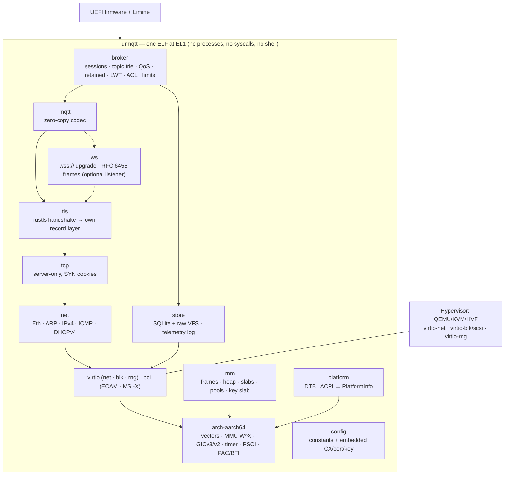
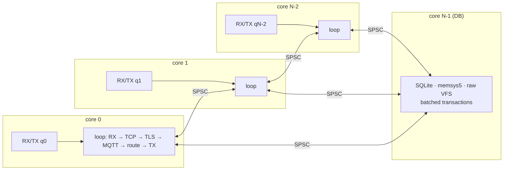
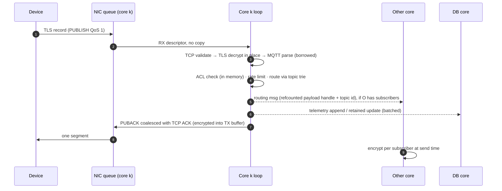

<div align="center">

# urMQTT

**A unikernel that *is* an MQTT broker, for aarch64 and x86_64.**
Kernel, TCP/IP, TLS 1.3, MQTT and an embedded database in one Rust binary, booted from one ISO.

[](https://github.com/zeljan-alduk/urMQTT/actions/workflows/ci.yml)
[](https://github.com/zeljan-alduk/urMQTT/actions/workflows/codeql.yml)
[](https://github.com/zeljan-alduk/urMQTT/actions/workflows/fuzz.yml)
[](https://scorecard.dev/viewer/?uri=github.com/zeljan-alduk/urMQTT)
[](#license)

-orange)

</div>

**Start here:** [the first hour](docs/FIRST-HOUR.md) (from nothing to a first message over mutual TLS) ·
[known issues](docs/KNOWN-ISSUES.md) (read before you deploy) · [editions](docs/EDITIONS.md) (what is open, what is
commercial) · [security policy](SECURITY.md) (report vulnerabilities privately).

> [!TIP]
> **Make your own ISO in the browser, no toolchain needed:** the **urMQTT builder** at
> **<https://aldo.tech/en/products/urmqtt-builder/>** (Croatian: <https://aldo.tech/proizvodi/urmqtt-builder/>, and 13 more languages
> under [aldo.tech/en/products/](https://aldo.tech/en/products/)). Pick a release, set the network (DHCP, a static address, or DHCP with a static
> fallback), your own certificates and keys, limits, the ACL and, if you need it, plain MQTT for a trusted network. Every field starts with its
> default. The page downloads the signed template ISO of the release, checks its signature and checksums, writes your configuration into it
> **inside your browser** (your keys never leave it) and hands you the finished ISO, which you can also try in an in-browser emulator first.
> Details: [Configure and download your ISO](#configure-and-download-your-iso).

> [!WARNING]
> **urMQTT is alpha** ([v0.5.0](https://github.com/zeljan-alduk/urMQTT/releases/tag/v0.5.0): the release
> kernel and a universal template ISO and raw image (aarch64 and x86_64) with an empty configuration, which the builder page or `urmqtt-config pack`
> configures; signed with the release key in `minisign.pub`). It serves MQTT 3.1.1 and MQTT 5.0 (QoS 0, 1
> and 2) over TLS 1.3 with mutual TLS and, only when an image's configuration turns them on, plain MQTT for a trusted
> network (P1) and MQTT over secure WebSocket (ADR-272). It keeps its state in SQLite in a raw partition of the disk it boots from.
>
> It has run under QEMU with HVF and TCG, and on two real machines: a netcup aarch64 KVM VPS and a Contabo x86_64
> KVM VPS (the latter at the H7 commit; the x86_64 code after it has not run on KVM). M0 to M17 are complete, and
> so is most of the work after them (the tables under [Roadmap](#roadmap) say which). What is missing, weak or
> unproven is in [docs/KNOWN-ISSUES.md](docs/KNOWN-ISSUES.md); [docs/PROGRESS.md](docs/PROGRESS.md) is the source of
> truth for what works.

## Editions

This repository is the open edition of urMQTT (Apache-2.0 OR MIT): the protocol, security, storage, the tools and
every virtio driver, for any hypervisor that gives the guest virtio devices. A commercial edition adds drivers for
devices that are not virtio (AWS ENA and NVMe, Google gVNIC, Azure, VMware, bare metal) and support, built on this
repository's releases. The line, and the promise that what is open stays open, are in [docs/EDITIONS.md](docs/EDITIONS.md).

> [!NOTE]
> **Where this stands** ([roadmap](docs/ROADMAP.md)):
> - **One multi-platform ISO** that boots on aarch64 and x86_64, by UEFI or legacy BIOS, and **installs itself** onto the machine's disk from its boot menu: built (X10, S1b). It runs wherever the machine exposes virtio devices; drivers for physical NICs and disk controllers (bare metal, X12 to X16) are the commercial edition's scope, see [Editions](#editions).
> - **One disk, no filesystem:** the data lives in a raw partition of the disk urMQTT boots from, with its own minimal, specified layout (S0 to S8): built.
> - **Security work aimed at an external audit:** the audit package exists (H10, [docs/AUDIT.md](docs/AUDIT.md)); the external audit has not happened.

---

## Contents

- [Why urMQTT](#why-urmqtt)
- [Features](#features)
- [Architecture](#architecture)
- [Repository layout](#repository-layout)
- [Getting started](#getting-started)
- [Configuration](#configuration)
- [Usage examples](#usage-examples)
- [Deployment](#deployment)
- [Development](#development)
- [CI/CD](#cicd)
- [Roadmap](#roadmap)
- [Contributing, security, license](#contributing)

---

## Why urMQTT

An IoT fleet mostly needs one thing from its server: hold millions of mostly idle, long-lived
connections, authenticate every device, and move small messages reliably. A typical broker
deployment puts Linux, OpenSSL, a language runtime, SSH, a package manager and a broker on top
of each other, and every layer adds attack surface, memory and moving parts.

urMQTT removes all of the layers except the broker:

| | Typical broker on Linux | urMQTT |
|---|---|---|
| Exposed services | SSH, broker, often a metrics/admin port | **TCP 8883** (MQTT over TLS 1.3 + mTLS); a plaintext MQTT port (P1) and a secure WebSocket port (`wss://`, 8084, ADR-272) only if the image's configuration turns them on (both off by default) |
| Code in the image | Kernel, userland, libc, OpenSSL, runtime | **One Rust ELF** (+ vendored SQLite) |
| Remote management | Shell, config files, package updates | **No shell, no login.** Revocations and the allowlist by signed control messages (H1); `$SYS` statistics and a small console over MQTT for operator certificates (O1, O2). A new version or configuration is a new image |
| Memory per idle connection | Kilobytes (socket buffers, TLS objects, heap) | **Target ≤ 512 B** |
| Multicore model | Threads and locks, or one event loop | **Thread-per-core, shared-nothing, run-to-completion** |
| Code integrity | Writable/executable mappings possible | **W^X, locked page tables, PAC/BTI** |

Priorities, in order: **security → scale → multicore performance → small footprint → immutable deployment.**

## Features

Legend: ✅ done · 🚧 in progress · 📋 planned (milestone)

| Area | Feature | Status |
|---|---|---|
| **Build** | Reproducible workspace, pinned toolchain, `--locked` everywhere | ✅ M0 |
| | Configuration as data: a validated, versioned blob in the image's slot (`urmqtt-config`), one release kernel for everyone | ✅ C1 |
| | Bootable ISO (Limine): aarch64 UEFI since M1; one universal ISO for aarch64 UEFI, x86_64 UEFI and x86_64 legacy BIOS | ✅ M1, X10 |
| | The ISO installs itself onto the machine's disk (boot menu, countdown, verified write) | ✅ S1b |
| | Bit-for-bit reproducible (checked in CI), minisign-signed images; ISO and raw GPT disk image | ✅ M17 |
| **Kernel** | EL1 exception vectors with decoded ESR/ELR/FAR reports | ✅ M1 |
| | Own page tables with W^X, guard pages, PAC/BTI when present | ✅ M2 |
| | GICv3, generic timer, monotonic clock | ✅ M3 |
| | GICv2 (KVM on GIC-400 hosts: Raspberry Pi 4/5), up to 8 CPUs | ✅ after M17 (TCG-tested) |
| | SMP bring-up, per-CPU data (`TPIDR_EL1`), SGI IPIs | ✅ M4 |
| | Hardware discovery via **DTB and ACPI** (MADT, GTDT, MCFG, SPCR) | ✅ M5 |
| **Devices** | PL011 UART, Limine framebuffer text log | ✅ M1 |
| | PCIe ECAM, virtio-pci modern: net, blk, rng | ✅ M6 |
| | Software dispatcher (Toeplitz/RSS hash) on one virtio-net queue pair | ✅ M13 |
| | virtio-net multiqueue + RSS | 📋 later (needs tap/vhost to test) |
| **Network** | Own DHCPv4 client, ARP, ICMP echo, strict IPv4 (no options, no fragments) | ✅ M14 |
| | Own server-only TCP: SYN cookies, timing wheel, NewReno, ACK coalescing, no TIME_WAIT | ✅ M14 |
| | IPv6 + SLAAC | 📋 later |
| **TLS** | TLS 1.3 only, **mutual TLS**, device id from CN or SAN URI | ✅ M10 |
| | rustls handshake, then own record layer (AES-128-GCM, ChaCha20-Poly1305, KeyUpdate) | ✅ M10 |
| | Session resumption (PSK tickets under random keys rotated every 12 h), handshake admission control, revocation list | ✅ M10, H2 |
| **MQTT** | Zero-copy 3.1.1 codec, fuzzed, `forbid(unsafe_code)` | ✅ M8 |
| | QoS 0/1, wildcards, retained, LWT, persistent sessions, keepalive | ✅ M9 |
| | QoS 2, exactly once (PUBREC/PUBREL/PUBCOMP, duplicates suppressed by packet id, flows resumed after a reconnect and, for an offline session, after a restart) | ✅ NEXT-2, ADR-271 |
| | ACL (`devices/{id}/#` by default), service identities, per-device rate limits | ✅ M9 |
| | Operator role: retained `$SYS/broker/#` statistics every 10 s, `$SYS/query/info`, a console over MQTT (`$SYS/console/{out,in}`: log lines, `help`, `status`, `log level`, `reboot`), mTLS only, audit-logged | ✅ O1, O2 |
| | MQTT over secure WebSocket (`wss://.../mqtt`, subprotocol `mqtt`) for browsers: a bounded HTTP Upgrade, a streaming RFC 6455 codec without reassembly, client certificate or a password inside TLS, an origin allowlist; Autobahn\|Testsuite clean | ✅ NEXT-5 (ADR-272) |
| | MQTT 5.0 beside 3.1.1 on every listener (TLS, plaintext, WebSocket): properties forwarded (user properties, content type, response topic and correlation data, payload format), reason codes on every acknowledgement and server DISCONNECT, session expiry (also for 3.1.1 persistent sessions: 30 days by default), message expiry, will delay, Receive Maximum and Maximum Packet Size both ways, topic aliases (client to broker), subscription options (No Local, Retain As Published, Retain Handling), assigned client id, Server Keep Alive; Paho interoperability suite and Mosquitto `-V mqttv5` clients | ✅ NEXT-3 part 2 (ADR-273, ADR-274) |
| | MQTT 5.0 shared subscriptions (`$share/{group}/{filter}`, also for 3.1.1 clients): a group per role class, round robin over its online members, bounded by `limits.max_shared_groups` and `limits.max_shared_group_members`; Subscription Identifiers (stored with persistent sessions); retained-message expiry swept; DISCONNECT 0x8B at `reboot`, 0x98 for a revoked certificate | ✅ NEXT-3 part 3 (ADR-275) |
| | Not supported, by decision: enhanced authentication (AUTH: CONNACK 0x8C); topic aliases from the broker to clients (never sent); MQTT 3.1 (protocol level 3) | by decision (ADR-275) |
| **Storage** | SQLite over a raw-disk VFS (WAL, exclusive), quick_check at boot; since H6 SQLite runs as an unprivileged program (EL0 / ring 3), not in the kernel | ✅ M11, ✅ H6 |
| | One disk: data in a partition of the boot disk (virtio-blk or virtio-scsi), created on the first boot, crash-safe; other disks never touched | ✅ S1 |
| | `urmqtt-disk`: offline info, verify, export (SQLite, telemetry), import devices, kernel update | ✅ S1 |
| | Layout v2: regions aligned to 1 MiB and the device's optimal I/O size, writes in whole physical blocks, A/B superblock; `urmqtt-disk migrate` (dry run, verify, rollback) from v1 | ✅ S2 |
| | The disk grows with the volume, at boot or online, crash-safe, never shrinks (`storage.grow_ratio_db`) | ✅ S3 |
| | Expired telemetry, truncated file tails and grown space are released to the disk (virtio-blk discard, virtio-scsi UNMAP), within the device's limits, rate limited, never in front of a commit (`storage.discard`) | ✅ S4 |
| | The database is copied into a backup region of the data partition (two slots, written alternately by SQLite's online backup API in bounded steps, the previous good one never touched) and restored at boot, logged loudly, if it is found corrupt (`storage.backup_interval_min`, `storage.auto_restore`) | ✅ S5 |
| | A background scrubber re-reads the database (`quick_check` per table, from the disk), the backups and the whole telemetry ring within an I/O budget, and reports bit rot with its position (`storage.scrub_interval_h`, `storage.scrub_io_budget_mb_s`); boot reads only the newest telemetry segment of each partition, not the ring | ✅ S6 |
| | Device registry, revocations, retained messages, persistent sessions with offline queues | ✅ M11 |
| | Per-core append-only telemetry log with CRC and crash recovery | ✅ M12 |
| **Scale** | Per-core event loops and broker shards, per-CPU heap caches, frame pools, cross-core fan-out | ✅ M13 |
| | ≤ 512 B per idle TLS connection (494 B measured at 10k), no per-device trie nodes | ✅ M15 |
| **Ops** | Handler watchdog (log / drop / reset), health check, rate-limited logs | ✅ M16 |
| | Syslog (RFC 5424) and statsd metrics over UDP to private collectors | ✅ M16 |
| | Admission that survives reconnect storms: free-heap reserve, in-flight limits per core and per source address | ✅ M16 |

## Architecture

The full design is in [docs/ARCHITECTURE.md](docs/ARCHITECTURE.md) and the decisions behind it
are in [docs/DECISIONS.md](docs/DECISIONS.md). The overview:

### Layers



### Execution model: thread-per-core, shared-nothing

Every data core runs its own loop with its own TCP stack, TLS states, broker shard (sessions,
topic trie), heap caches and telemetry partition. Cores share no mutable state, only bounded
lock-free **SPSC rings**, one per ordered pair of cores. The highest-numbered core runs SQLite and
nothing else.

Today (M13) the NIC has one queue pair, owned by **core 0**, which steers every MQTT flow by the
Toeplitz (RSS) hash of its 4-tuple to a **worker core** (1 … N-2) and transmits what the workers
send back. A session lives on its **home** worker (`fnv1a(client id)`), so takeover, wills and
persistence never cross cores. A connection that lands on another worker keeps its TCP and TLS
there and relays plaintext MQTT to the home core, with credit-based flow control. A secure WebSocket connection (ADR-272) is the same with one more layer on its transport core: the RFC 6455 codec between TLS and MQTT takes the frames off before anything is relayed, so the home core and the broker see plain MQTT bytes. Every routed
message is fanned out to the other shards, each of which keeps a replica of the retained messages.



- **Run to completion.** A received packet is processed fully on one core, from TCP through TLS decrypt-in-place, MQTT parse and routing to the encrypted reply, with no task queues and no copies into application buffers.
- **Adaptive polling.** Under load the RX queues are busy-polled. When idle the core falls back to interrupts and `WFI`. Interrupt handlers only acknowledge and mark work.
- **Watchdog.** A 10 ms per-core tick catches handlers that overrun their budget.

### The life of a PUBLISH



### Memory per connection

The target is **≤ 512 B per idle TLS connection** (stretch goal ~256 B). Nothing per connection is
buffered while it is idle: receive data is processed straight from the frame, and send, record and
MQTT buffers exist only while something is incomplete or unacknowledged. The kernel measures it
itself (ADR-034): exact heap counters in requested bytes and in the buddy blocks they occupy, logged
every 10 s as heap above the idle baseline per open connection.

| Part | Size | How |
|---|---:|---|
| TCP control block | 96 B | packed flags, 16-bit RTT/RTO, wheel timer slot, no idle buffers |
| TCP table slot | 4–8 B | connection index only, ≤ half full |
| Connection + TLS 1.3 record state | 152 B | secret + sequence per direction (40 B); key and IV derived per record |
| MQTT connection | 48 B | identity and Will boxed only while present |
| MQTT session, hot form | 64 B | one subscription inline, interned node ids |
| Subscription `devices/<id>/cmd/#` | 0 trie nodes | stored relative to the session's own id, shared by all devices |

**Measured** (HVF, 4 vCPU, 3 worker cores; every device holds an mTLS connection and one QoS 1
subscription; heap blocks including allocator rounding, frame-buffer pool excluded):

| Connections | Bytes per connection |
|---:|---:|
| 960 | 531 B |
| 9 922 | 494 B |
| 10 197 | 474 B |

An MQTT 5.0 connection keeps a 24-byte state box and its connection's side box for its life: at 2000 connections
it measured 670 B against 509 B for 3.1.1 on the same kernel (ADR-274).

The frame-buffer pool is a fixed ~2 MiB (≈ 200 B per connection at 10k, ≈ 2 B at 1M). 100k and 1M
connections could not be generated on the development host. QEMU user networking on macOS stopped
accepting at 10 197 connections, about the 10 240-descriptor `OPEN_MAX` of the QEMU process. One
loopback address also has only 16 384 ephemeral ports, and adding addresses needs root. The figure
falls as fixed slab chunks amortize, so it does not grow with the connection count.

### Security model

- **One port.** TCP 8883: TLS 1.3 only, client certificates required, signed by the CA in the image's configuration. The MQTT client id must equal the certificate's device id. Two more ports exist only when an image turns them on: plaintext MQTT for trusted networks (P1) and MQTT over secure WebSocket (ADR-272: TLS 1.3, a client certificate or a password checked inside TLS, an origin allowlist).
- **No ways in.** No shell, console input, SSH, admin API, dynamic code, network-reachable SQL or filesystem.
- **Memory safety.** Rust, with `forbid(unsafe_code)` in the protocol crates, every `unsafe` block justified with a `// SAFETY:` comment (lint-enforced), and no panics on external input (clippy denies `unwrap`, `expect`, indexing and `panic!` in data-path crates).
- **Exploit mitigation.**
  - W^X is enforced by the descriptor encoding and by `SCTLR_EL1.WXN`, and audited on every boot.
  - Page tables are read-only after boot, with no writable alias left.
  - The lower half of the address space is disabled.
  - Every stack has guard pages, and exceptions run on a separate stack.
  - PAC (`pac-ret`) and BTI are enabled when the CPU supports them, and verified by the smoke tests.
- **Abuse resistance.** SYN cookies; admission refuses new connections (before any crypto) on a low heap, a DB core that is behind, too many handshakes in flight per core or per source address, or the handshake rate. Per-device rate limits, bounded queues, a TCP window tied to broker backpressure, rate-limited logs, a handler watchdog and a health check.
- **Immutable, except who may connect.** Configuration, trust anchors and server key are in the image's configuration slot (the kernel itself never changes), and changing them means a new slot, not a new kernel. Revocations and the device allowlist change at runtime through control messages that need a control identity's mTLS certificate **and** an offline Ed25519 signature (H1, [docs/SECURITY.md](docs/SECURITY.md#control-channel-h1)).

The threat model is in [docs/SECURITY.md](docs/SECURITY.md); the cryptography (keys, record layer, tickets, constant-time and conformance results) in [docs/CRYPTO.md](docs/CRYPTO.md).

### Persistence

The data lives in the urMQTT data partition of the disk the VM boots from, with no filesystem
(single-disk model, [docs/DISK-FORMAT.md](docs/DISK-FORMAT.md) §0). The first boot of the image on a larger
disk moves the backup GPT to the end, gives the disk its own GUID and creates the partition, crash-safely;
no other disk is ever written. Inside the partition:

```
LBA 0      [ superblock: magic · layout version · uuid · region table · CRC-32C ]
LBA 8, 16  [ file-size table, slots A/B (newest valid wins) ]
LBA 64     [ SQLite main DB ½ ][ SQLite WAL ⅛ ][ journal 1 MiB ][ telemetry log: 8 partitions … ]
last 4 KiB [ scratch for the boot block-device self-test ]
```

- **SQLite** (vendored 3.54.1, checksum-verified at build time) is compiled with clang, freestanding, into a separate unprivileged program (`crates/dbworker`, EL0 / ring 3, embedded in the image; ADR-210) and uses a fixed `memsys5` heap in that program's address space. Its VFS maps three fixed files onto disk regions; there is no filesystem. It runs in WAL mode with `locking_mode=EXCLUSIVE` (so no shared-memory index) and `synchronous=FULL`, and the boot fails safe on `quick_check` errors. It holds the device registry, revocations, retained messages and persistent sessions with their offline QoS 1 queues.
- **The DB core** (the highest-numbered CPU) runs the store, and so calls the database worker, and nothing else. The data plane sends it state changes over a lock-free SPSC ring; it batches them into one transaction per 5 ms or 512 operations and reports commits on a second ring. A blank data partition is formatted on first boot; a damaged one is refused and left as it is, never formatted over.
- **Telemetry**: every accepted PUBLISH on `storage.telemetry_topics` goes to its core's partition of the telemetry log, a ring of segments with a CRC per record (salted with the segment sequence, so old ring passes never reappear). Cores hand records to the DB core over their own SPSC ring without copying. The DB core flushes every 5 ms or 256 KiB. On boot, recovery keeps every flushed record, truncates a torn tail and continues in a fresh segment. Retention is by size (the ring) and by age (`retention_days`).

## Repository layout

```
urMQTT/
├── PROMPT.md               full specification and milestone plan (source of truth)
├── Makefile                every entry point (make help)
├── rust-toolchain.toml     pinned nightly (ADR-002)
├── crates/
│   ├── kernel/             the binary: boot, core loop, wiring
│   ├── arch/               architecture facade with its API contract (ADR-040)
│   ├── arch-aarch64/       vectors, MMU, GICv3/v2, timer, PSCI, PAC/BTI, RNDR (all assembly lives here)
│   ├── sync/               spinlock, once-cell, SPSC ring (architecture-neutral)
│   ├── dispatch/           CPU feature set and backend selection, `[cpu] disable` (ADR-041)
│   ├── platform/           DTB + ACPI discovery
│   ├── mm/                 frames, heap, slabs, pools
│   ├── pci/  virtio/       PCIe ECAM + MSI-X, virtio net/blk/scsi/rng
│   ├── log/                per-CPU log rings and sinks
│   ├── net/  tcp/          IPv4 stack, server-only TCP
│   ├── tls/                TLS 1.3 (rustls handshake + record layer)
│   ├── mqtt/  broker/      codec and broker core
│   ├── timer-wheel/        hierarchical timing wheel
│   ├── store/              SQLite FFI, VFS, telemetry log, boot-disk GPT, fault injection
│   ├── control/            signed control messages: format, Ed25519, freshness (H1)
│   ├── cfg/                no_std configuration blob: format, field table, checks (ADR-215)
│   ├── config/             no_std typed view of the loaded configuration
│   └── config-schema/      TOML schema, validation, codegen (host)
├── deploy/{dev,prod}/      config.toml per environment (certificates are never committed)
├── scripts/                gen-dev-certs.sh, mkiso.sh, run-qemu.sh, smoke.sh, check scripts
├── fuzz/                   cargo-fuzz targets
├── tools/loadgen/          host-side MQTT/TLS load generator
├── tools/control/          urmqtt-control: sign and publish control messages (H1)
├── tools/disk/             urmqtt-disk: offline disk info, verify, export, import, update (S1)
├── tools/attack/           host-side adversarial clients: TCP floods, slowloris, … (H3, dev only)
├── vendor/                 pinned Limine and SQLite, with checksums
└── docs/                   ARCHITECTURE, DECISIONS (ADRs), PROGRESS, DEPLOY, SECURITY
```

## Getting started

### Prerequisites

**macOS on Apple Silicon** (the primary dev platform):

```bash
# Rust (https://rustup.rs). The pinned toolchain installs itself from rust-toolchain.toml.
curl --proto '=https' --tlsv1.2 -sSf https://sh.rustup.rs | sh

brew install qemu xorriso llvm mosquitto openssl@3   # llvm: clang + llvm-ar for SQLite; OpenSSL >= 3
cargo install cargo-fuzz --locked      # optional, for make fuzz
```

**Linux (aarch64 or x86_64 host)**:

```bash
sudo apt install qemu-system-arm qemu-efi-aarch64 xorriso clang llvm mosquitto-clients openssl
```

### Build and check

These steps work today:

```bash
git clone https://github.com/zeljan-alduk/urMQTT.git
cd urMQTT
rustup toolchain install     # installs nightly-2026-10-20 + rust-src, clippy, rustfmt, llvm-tools
make certs                   # dev CA, server cert, 3 device certs, negative-test certs
make check                   # fmt + clippy (host and aarch64-unknown-none) + host tests
make build                   # target/aarch64-unknown-none/release/urmqtt
```

`make help` lists every target.

### Boot it (works today)

```bash
make disk                    # build/disk-dev.img: the raw image on a 1 GiB sparse disk
                             # (next time: only the kernel is replaced, the data stays)
make run                     # QEMU + HVF, 4 vCPU, 512 MB, serial on stdio (runs make disk)
```

Expected serial output (HVF, 4 vCPU, 512 MB):

```text
URMQTT BOOT 0.0.1 cpu=4 mem=503
[    5.137] INFO  env=dev el=1 bootloader=Limine 12.9.4
[    5.137] INFO  platform: Acpi, uart=0x9000000, psci=Some(Hvc)
[    5.137] INFO  console: pl011 at 0x9000000 mapped at 0xffff800000000000
[    5.138] INFO  psci 1.1 via hvc
[    5.138] INFO  framebuffer: 800x600 text console
...
URMQTT READY
```

Boot also builds the kernel's own address space and audits it before announcing readiness:

```text
[    5.162] INFO  cpu features: pauth=true fpac=true bti=true rndr=false aes=true pmull=true ...
[    5.164] INFO  vm: kernel tables built (45 table pages), 442 MiB free, heap 32 MiB
[    5.164] INFO  vm: switched to kernel tables (TTBR1), lower half disabled, WXN on
[    5.165] INFO  vm: running on kernel stacks (main 128 KiB ...), pac=on bti=on
[    5.166] INFO  vm: page tables locked (2048 KiB read-only, no writable alias)
[    5.167] INFO  selftest: W^X ok (13385 leaf mappings audited, 0 W+X, text-only execute, ...)
[    5.186] INFO  gic: v3 at gicd=0x8000000 gicr=0x80a0000, 1020 lines, msi via GICv2m frame
[    5.423] INFO  timer: irq latency (busy-poll, 25 samples) min=1916 avg=3869 p99<=8192 max=7750 ns
[    5.675] INFO  timer: irq latency (wfi, 25 samples) min=110000 avg=1810114 ... ns
```

With `make run-smp N=8` every core comes online and every pair of cores exchanges an IPI:

```text
[    5.681] INFO  cpu 7 online (mpidr=0x7, el=1)
[    5.682] INFO  smp: 8/8 cpus online (7 application processors started)
[    5.683] INFO  ipi: 56/56 ordered pairs ping-pong ok, round trip avg=11943 ns max=29000 ns
[    5.739] INFO  smp: 8/8 cpus ticking on their own timer
```

Devices are enumerated and tested on every boot:

```text
[    5.185] INFO  pci: ECAM 0x4010000000 buses 0-255, 5 function(s)
[    5.186] INFO  pci 00:03.0 1af4:1001 class 01.00 virtio-blk
[    5.187] INFO  blk: 64 MiB, block size 512, flush=true, read-only=false, msi-x=yes
[    5.188] INFO  net: mac 52:54:00:12:34:56, link up
[    5.189] INFO  entropy: 64 bytes from virtio-rng
[    5.189] INFO  entropy: ChaCha20 CSPRNG seeded
[    5.695] INFO  blk: self-test ok (4 KiB random pattern written, flushed, read back at sector 131064)
[    5.696] INFO  msi-x: 3 blk completion interrupt(s) via GICv2m
[    5.696] INFO  net: gratuitous ARP sent
[    5.696] INFO  net: rx ok, ARP reply from 52:55:0a:00:02:02
```

Under HVF an IRQ reaches a busy-polling core in about 4 µs, while a core asleep in `wfi` wakes
after about 2 ms. That gap is why the data plane busy-polls under load and sleeps only when idle
([ADR-022](docs/DECISIONS.md)).

`make smoke` boots twelve scenarios under HVF and TCG and checks the decoded reports:
- ACPI and device-tree discovery
- data abort, undefined instruction, resumable `brk`, panic
- write to kernel text, executing heap memory
- stack overflow into the guard page, null pointer
- forged return address (PAC), branch to a non-landing pad (BTI)

A data abort report looks like this:

```text
!!! EXCEPTION: synchronous, current EL, SPx
    EC=0x25 data abort (same EL), read, translation fault, level 2 (ISS=0x0000006, IL=1)
    ESR=0x0000000096000006 ELR=0xffffffff8000481c FAR=0xffff80003ffff000 SPSR=0x800003c5
    x0 =0x0000000000000000 x1 =0x000000000000000a ...
!!! fatal exception, stopping
```

## Configuration

The kernel is built **once** and is the same for everyone. Its configuration is **data**: a compact,
versioned blob (`urmqtt-cfg`, [ADR-215](docs/DECISIONS.md)) in a fixed 256 KiB slot that the bootloader
hands the kernel as a module (`/boot/urmqtt.cfg` in the ISO and on the installed disk's ESP). It holds
the limits, ACLs, network, the TLS server certificate and key, the trust anchors and the control public
key. The kernel checks it again at every boot and **refuses** one it does not understand, a development
option on a release kernel (a plaintext port, for example), or a bad signature. An image whose slot is
empty (the template) boots on the documented defaults but **does not serve** until it has a server
certificate, its key and a CA.

### Configure and download your ISO

No toolchain and no command line: the **urMQTT builder** page on aldo.tech
([aldo.tech/en/products/urmqtt-builder/](https://aldo.tech/en/products/urmqtt-builder/), also in Croatian and 13 other
languages) is the same `urmqtt-config` compiled to WebAssembly ([ADR-225](docs/DECISIONS.md)). You choose a release, pick a
preset (a lab VM on DHCP, a VPS with a fixed address, DHCP first with a fixed fallback) or leave every field at its default,
add your CA, server certificate and key, and download `urmqtt-<version>-<name>-universal.iso`.

- **Nothing leaves the browser.** Certificates, private keys, settings and the finished ISO stay on your computer; the page only
  downloads release files from its own site (no third-party scripts, no tracking, `connect-src 'self'`). The address bar and
  `sessionStorage` keep the settings and the public certificates for a reload, never a private key.
- **Releases are checked in the browser.** The template ISO, `SHA256SUMS` and its minisign signature come from a mirror of the
  GitHub releases on the same site, but the page does not trust the mirror: it verifies the signature against the release key
  built into the page (`minisign.pub`, and for v0.1.0 to v0.4.1 only the former test key in `keys/`) and the template against the signed sums, and a failed check blocks the build unless you
  override it in a dialog. Releases built before the runtime configuration existed are listed greyed out, with the reason.
- **Same bytes as the command line.** The page and `urmqtt-config pack --iso` produce identical images for the same input (a test
  in `make check` builds the same configuration both ways in headless Chrome). Every field of the form has a default, shown as its
  placeholder; a field you do not touch is not written, so a newer kernel's defaults apply. You can import and export a
  `config.toml`, so a result of the page can be reproduced offline. The page shows the SHA-256 of the file and the configuration
  fingerprint the kernel prints at every boot ([trust statement](docs/SECURITY.md#configured-images-what-is-attested-c1-adr-219)).
- **Optional: try it in the emulator.** A second button loads, only when clicked, an x86-64 emulator in WebAssembly and starts
  the image you just built, with its console on a canvas (see [ADR-228](docs/DECISIONS.md) for what it can and cannot show).

The page works on releases that contain a template ISO with its `SHA256SUMS` and signature. v0.1.0 predates the runtime
configuration, so until the first release that has one is published the page says so plainly (the release is greyed out with
the reason and a link to the releases on GitHub) and offers only what works without it: the form, a `config.toml` export and
files from your computer. Pictures of the page on aldo.tech as it is today, with no release yet: [desktop](docs/screenshots/live-desktop.png),
[phone](docs/screenshots/live-phone.png), [dark](docs/screenshots/live-dark.png), [a dialog](docs/screenshots/live-dialog.png),
[the Products page](docs/screenshots/live-products.png), and [the emulator](docs/screenshots/live-emulator.png) (booting the real template
ISO chosen from the computer). With a release to build from (taken against a test mirror signed with a throwaway key, the release names
are the fixture's): [desktop](docs/screenshots/builder-desktop.png), [phone](docs/screenshots/builder-phone.png),
[dark](docs/screenshots/builder-dark.png), [a dialog](docs/screenshots/builder-dialog.png), [the emulator](docs/screenshots/builder-emulator.png).

The page opens in a **simple view** (three steps: where it runs, drop your certificate, key and CA in one go, name the image; the release is chosen and checked for you) and has an **Advanced** switch with every option, a search and a "changed from default" filter; both edit the same settings ([simple](docs/screenshots/simple-ready.png), [result](docs/screenshots/simple-result.png), [advanced](docs/screenshots/advanced-search.png), [phone](docs/screenshots/simple-phone.png)). In the emulator you can pick the boot entry (urMQTT or Diagnostic) and use your keyboard.

`make builder` builds the page (WebAssembly module, script, style and texts) into `build/builder/`; `make builder-test` runs its
tests. The directory is static: any web server that also serves a `releases.json` (made by `scripts/mirror-releases.py`)
can host it.

### Making a configured image

The source is the same `config.toml` as always (`deploy/<env>/config.toml`), now with **defaults for
every key you leave out**, plus the PEM files it names.

```bash
# cargo build --release -p urmqtt-config-tool      (the tool is built from this repository)
# from a release: the template ISO has the empty configuration
urmqtt-config pack my.toml --iso urmqtt-template-<version>-universal.iso --out my.iso
urmqtt-config show my.iso          # fingerprint, signature, every non-default value
urmqtt-config verify my.iso        # the kernel's checks, every copy of the slot, every module hash
urmqtt-config schema               # all keys: type, default, range, help, dev-only (JSON)

# from a checkout: make dist / make iso pack deploy/$ENV/config.toml with the same tool
make dist-universal ENV=prod
```

`pack` reads the files the TOML names (relative to it, or `--root DIR`), checks them (PEM structure,
certificate expiry against `tls.min_server_cert_days` and `trust.min_anchor_days`, the control key) and
prints the **fingerprint** (SHA-256 of the canonical bytes). The same configuration always gives the same
bytes. The kernel prints the fingerprint on every boot (`config: fingerprint ... unsigned, env=prod`),
so you can compare it with what the tool showed. `--sign KEY.pem` adds an optional Ed25519 signature
over the fingerprint (off by default; see [docs/SECURITY.md](docs/SECURITY.md#configured-images-what-is-attested-c1-adr-219)).
Keys stay on your machine: the tool uploads nothing, and the browser builder above works the same way.
A patched ISO is not the released ISO and has no official hash; the template it came from does.

Invalid input **fails `pack`** (and `make dist`) with every error listed at once:

```text
$ urmqtt-config pack deploy/bad/config.toml --out bad.blob
error: invalid configuration deploy/bad/config.toml:
  - network.mqtt_plain_port: plaintext MQTT is only allowed in ["dev"], set it to 0
  - limits.max_inflight_qos1: must be greater than 0
```

### Reference

Every key has a default (`urmqtt-config schema` prints key, type, default, range, help and whether a
non-default value is allowed outside `env = "dev"`). The kernel sizes its configuration tables without an
allocator, so lists have documented maxima (also in the schema): 64 entries per ACL list, 1024 revoked
serials, 8 CA files per role, 4 NTP servers; the slot holds 256 KiB in all.

| Key | Type / values | Meaning |
|---|---|---|
| `network.mode` | `"dhcp"` \| `"static"` \| `"auto"` | Address configuration. DHCP lets one ISO serve many VMs; `auto` tries DHCP first and falls back to the static settings |
| `network.address`, `network.gateway` | `"a.b.c.d/len"`, `"a.b.c.d"` | Required for `static` and `auto`, forbidden for `dhcp` |
| `network.dhcp_timeout_s` | 3–120 (default 15) | `auto` only: how long to wait for a lease before the static settings are used (also used at once when a lease is lost) |
| `network.mtu` | 0 or 576–9000 (default 0) | Largest IPv4 packet. 0: the MTU from DHCP option 26, else 1500; set it on a smaller network that does not announce it (Google Cloud with a static address: 1460). TCP segments follow it (MSS = MTU − 40); frames above 1500 bytes are never sent. Needs configuration format 7 (ADR-264, DEPLOY.md "Cloud networks and MTU") |
| `network.mqtt_tls_port` | 0–65535 | MQTT over TLS listener (8883); 0 turns it off (only with `plaintext.enabled`, ADR-233) |
| `network.mqtt_plain_port` | 0 or port | Development plaintext port (the identity is the client id); **non-zero only in `dev`**. A release image gets plaintext MQTT only from `[plaintext]` below |
| `tls.cert`, `tls.key` | file names in `deploy/<env>/` | Embedded server PEMs; encrypted keys are rejected |
| `tls.min_server_cert_days` | ≥ 1 (60) | The build fails if `server.pem` expires sooner; runtime warnings from this many days |
| `tls.early_data` | `false` | 0-RTT is replayable: `true` fails the build |
| `trust.operational` | CA file names (≥ 1) | Anchors granting device and service rights; two side by side = CA rotation with overlap |
| `trust.bootstrap` | CA file names | Anchors granting only `provision/{id}/#` ([docs/PROVISIONING.md](docs/PROVISIONING.md)) |
| `trust.min_anchor_days` | ≥ 1 (365) | The build fails if an anchor expires sooner |
| `registry.mode` | `"open"` \| `"allowlist"` | `allowlist`: only device ids on the runtime allowlist connect |
| `control.public_key` | file name | Ed25519 public key verifying control messages; the private key stays offline |
| `control.service_ids` | exact ids (or `[]` = off) | Operational identities that may publish to `$urmqtt/control` |
| `control.allow_unrevoke` | bool | Whether `unrevoke` is accepted (keep `false` in production) |
| `control.max_message_age_s` | 1–86 400 | Longest validity window of a control message |
| `plaintext.enabled` | bool, default `false` | **Plaintext MQTT, no TLS, for trusted networks** (P1). Off unless you turn it on; read [the section below](#plaintext-mqtt-on-a-trusted-network-p1) first |
| `plaintext.port` | 1–65535 (1883) | Its TCP port; not the TLS port |
| `plaintext.allow_from` | `["10.0.0.0/8", ...]` (up to 64) | **Required** when enabled: the networks that may connect. A source outside gets no answer to its SYN (no state kept). `0.0.0.0/0` is refused |
| `plaintext.allow_from_anywhere` | bool, default `false` | Say it out loud: every address may connect. Loud warnings at build and at boot; never on a machine with a public address |
| `plaintext.auth` | `"password"` (default) \| `"anonymous"` \| `"ip"` | Who a client is: the user name if its password matches, `anonymous_identity`, or the identity of its source network |
| `plaintext.users` | `[{ id = "...", password_hash = "..." }]` (up to 256) | The accounts of `auth = "password"`; the hash comes from `urmqtt-config hash-password` or the builder page, never the password |
| `plaintext.anonymous_identity` | identity (`lan`) | The identity of every client with `auth = "anonymous"` |
| `plaintext.ip_identities` | `[{ from = "10.1.0.0/16", id = "..." }]` (up to 64) | The identity of each source network with `auth = "ip"` (longest match) |
| `plaintext.max_connections` | 1–1 000 000 (1000) | Connections of the plaintext port, all cores |
| `plaintext.max_connections_per_ip` | 1–65 535 (16) | Of those, from one source address |
| `plaintext.max_packet_size` | 64 – 268 435 455 (1024) | Largest MQTT packet a plaintext client may send |
| `plaintext.publish_rate_per_device` | `"N/s"`, `"N/m"`, `"N/h"` (`"5/s"`) | Token bucket per plaintext session |
| `plaintext.max_failed_auths_per_ip` | 1–1000 (5) | Failed logins from one address, within `lockout_s`, that lock it out |
| `plaintext.lockout_s` | 1–86 400 (300) | How long a locked-out address gets no answer |
| `plaintext.acl_publish`, `plaintext.acl_subscribe` | topic filters, up to 16, `{id}` = identity (`devices/{id}/#`, `devices/{id}/cmd/#`) | What a plaintext client may publish and subscribe to; never `$SYS` |
| `plaintext.retain` | bool, default `false` | May plaintext clients publish retained messages (otherwise delivered, not stored) |
| `websocket.enabled` | bool, default `false` | **MQTT over secure WebSocket** (`wss://`, TLS 1.3, subprotocol `mqtt`) for browsers and web stacks (ADR-272). Needs the TLS listener (`network.mqtt_tls_port` not 0), whose certificate and key it uses. Any `[websocket]` key set needs configuration format 9 |
| `websocket.port` | 1–65535 (8084) | Its TCP port; not the TLS, plaintext or development port |
| `websocket.path` | `"/..."`, up to 64 characters (`"/mqtt"`) | The URL path clients connect to (`wss://host:8084/mqtt`); letters, digits and `- . _ ~ /` only, no `.` or `..` segments. Any other path is answered 404 |
| `websocket.auth` | `"mtls"` (default) \| `"password"` | `mtls`: a client certificate, exactly as on the TLS port (identity, roles, revocation, the broker's limits and ACL). `password`: no client certificate; a user name and password from `websocket.users`, checked inside TLS, with the section's own limits and ACL below |
| `websocket.origins` | exact origins, up to 16 (`[]`) | Web pages allowed to connect, as browsers send them: `"https://app.example.com"`, `"http://localhost:3000"` (lower case, no path, no trailing slash, no default port, no wildcard, not `null`). An upgrade from another origin gets 403. **Required** with `auth = "password"`; empty with `mtls` admits any origin |
| `websocket.users` | `[{ id = "...", password_hash = "..." }]` (up to 256) | The accounts of `auth = "password"`, as in `plaintext.users` (hash from `urmqtt-config hash-password` or the builder page); refused with `mtls`; an id may not be a service, operator or control identity |
| `websocket.upgrade_timeout_s` | 1–10 (5) | Seconds from the TCP connection to a complete upgrade request (TLS handshake included) |
| `websocket.max_connections` | 1–1 000 000 (1000) | WebSocket connections, all cores |
| `websocket.max_connections_per_ip` | 1–65 535 (16) | Of those, from one source address |
| `websocket.max_packet_size` | 64 – 268 435 455 (16 384) | `password` only: largest MQTT packet a client may send (with `mtls`, `limits.max_packet_size`) |
| `websocket.publish_rate_per_device` | `"N/s"`, `"N/m"`, `"N/h"` (`"10/s"`) | `password` only: token bucket per session |
| `websocket.max_failed_auths_per_ip` | 1–1000 (5) | `password` only: failed logins from one address, within `lockout_s`, that lock it out |
| `websocket.lockout_s` | 1–86 400 (300) | `password` only: how long a locked-out address gets no answer |
| `websocket.acl_publish`, `websocket.acl_subscribe` | topic filters, up to 16, `{id}` = account id (`web/{id}/#`) | `password` only: what a client may publish and subscribe to; never `$` topics |
| `websocket.retain` | bool, default `false` | `password` only: may clients publish retained messages |
| `tls.identity_field` | `"cn"` \| `"san_uri"` | Certificate field that becomes the `device_id` |
| `tls.resumption` | bool | TLS 1.3 PSK session resumption |
| `tls.revocation_list` | file name or `""` | Revoked client-certificate serials (hex, one per line); runtime revocations come on top (H1) |
| `limits.max_connections_per_core` | > 0 | Admission limit per core |
| `limits.max_packet_size` | 64 – 268 435 455 | Largest accepted MQTT packet |
| `limits.max_topic_len`, `max_topic_levels` | ≤ 65 535, > 0 | Topic bounds, checked before any allocation |
| `limits.max_subscriptions_per_session` | > 0 | |
| `limits.max_inflight_qos1` | > 0 | Unacknowledged QoS 1 and QoS 2 deliveries per session (a QoS 2 one until its PUBCOMP); also the QoS 2 ids a client may hold awaiting PUBREL, at least 64 (ADR-271) |
| `limits.max_queued_per_offline_session` | ≥ 0 | Bounded offline queue |
| `limits.max_retained_per_device` | ≥ 0 | Retained messages one identity may hold; more are delivered but not retained (H3) |
| `limits.max_retained_bytes` | 1 – heap/8 | Retained topics and payloads per data core (each core holds a replica), plus 128 B each |
| `limits.publish_rate_per_device` | `"N/s"`, `"N/m"`, `"N/h"` | Token bucket per device |
| `limits.handshakes_per_core_per_sec` | > 0 | Handshake admission control (reconnect storms) |
| `limits.max_handshakes_in_flight_per_core` | > 0 | Concurrent handshakes per core; more are refused |
| `limits.max_handshakes_in_flight_per_ip` | > 0 | Of those, from one source address |
| `limits.max_connections_per_ip` | 0 – 1 000 000 (1024) | Established TLS connections (MQTT and WebSocket) one source address may hold at once, all cores together; 0: no limit. Over it the SYN gets no answer before any TLS work, and the refusal is counted in `$SYS/broker/connections/per_address/*`. Devices behind one NAT share an address. Set (0 included), it needs configuration format 14 (ADR-280) |
| `limits.max_session_expiry_s` | 0 – 4 294 967 295 (2 592 000 = 30 days) | The longest Session Expiry Interval granted, to MQTT 5.0 clients and 3.1.1 persistent sessions alike; 4 294 967 295 = never expire (ADR-273). Set, it needs configuration format 12, like every key below |
| `limits.default_session_expiry_s` | 0 – 4 294 967 295 (2 592 000) | The Session Expiry Interval of a 3.1.1 persistent session (`clean_session` 0); at most `limits.max_session_expiry_s` |
| `limits.max_message_expiry_s` | 0 – 4 294 967 295 (0) | The longest Message Expiry Interval a publisher may ask for; 0: no cap |
| `limits.max_shared_groups` | 1–65 535 (1024) | Shared-subscription groups (`$share/{group}/{filter}`) one data core may own; a SUBSCRIBE that would create one more gets SUBACK 0x97 (MQTT 5.0) / 0x80 (3.1.1). Each group lives on one core chosen by a hash of (role class, group, filter) (ADR-275). Set, it needs configuration format 13 |
| `limits.max_shared_group_members` | 1–65 535 (1024) | Members one shared-subscription group may have; one more gets SUBACK 0x97 / 0x80. Set, it needs configuration format 13 |
| `mqtt5.enabled` | bool, default `true` | Accept **MQTT 5.0** clients (CONNECT with protocol level 5) on every listener (ADR-273); `false`: they get CONNACK 0x84 and are closed. Any `[mqtt5]` key set needs configuration format 12 |
| `mqtt5.receive_maximum` | 1–65 535 (32) | Announced Receive Maximum: QoS 2 publications a 5.0 client may have awaiting PUBREL; one more is DISCONNECT 0x93 |
| `mqtt5.topic_alias_maximum` | 0–65 535 (10) | Announced Topic Alias Maximum (client to broker only); 0 disables aliases. A connection that uses aliases may hold up to `topic_alias_maximum` × (`limits.max_topic_len` + 16) bytes |
| `mqtt5.max_user_properties` | 0–1024 (16) | User Properties per property block; a packet with more is refused (0x83) |
| `mqtt5.max_keep_alive_s` | 0–65 535 (0) | 0: a 5.0 client keeps the keep alive it asked for; otherwise the most it gets (Server Keep Alive in CONNACK) |
| `mqtt5.shared_subscriptions` | bool, default `true` | Shared subscriptions (`$share/{group}/{filter}`, MQTT 5.0 4.8.2; also for 3.1.1 clients): each matching message goes to one member of the group. `false`: CONNACK announces Shared Subscription Available 0 and a `$share/` filter gets SUBACK 0x9E (3.1.1: 0x80) |
| `mqtt5.subscription_identifiers` | bool, default `true` | Subscription Identifiers (MQTT 5.0 3.8.2.1.2): returned in each PUBLISH the subscription matched. `false`: CONNACK announces Subscription Identifier Available 0 and a SUBSCRIBE that carries one gets SUBACK 0xA1 |
| `acl.device_publish`, `acl.device_subscribe` | topic filters, `{id}` = device id | Default device rights |
| `acl.service_ids` | ids or `prefix*` | Identities with service rights (backends) |
| `acl.service_publish`, `acl.service_subscribe` | topic filters | Service rights |
| `acl.operator_ids` | exact ids (required, may be empty) | Operator identities: the only ones that read `$SYS/` statistics and use the MQTT console ([docs/OPERATE.md](docs/OPERATE.md)) |
| `memory.kernel_heap_mb` | power of two, 1–1024 | Kernel heap (buddy allocator); ~500 B per idle connection, ~150 KiB per P-256 trust anchor (ADR-261) |
| `memory.min_free_mb` | > 0, < heap | New connections are refused below this much free heap |
| `entropy.fallback` | `jitter` (default) \| `none` | Without virtio-rng and `RNDR`/`RDRAND`: `jitter` seeds from health-tested CPU jitter and the firmware's values (weaker than a hardware source; the boot log, `$SYS/broker/entropy/source` and `urmqtt-config pack` say so); `none` refuses to boot (ADR-263) |
| `storage.mode` | `disk` \| `auto` \| `ram` | Where the data lives (required outside dev). `auto`: the disk, but the ISO's live entry runs from RAM, ephemeral; `ram`: always RAM; `disk`: the live entry is refused (docs/DEPLOY.md, ADR-061) |
| `storage.ram_percent` | 2–50, default 10 | Live/RAM mode: share of RAM for the in-memory data store, subtracted from the connection budget (ADR-062) |
| `storage.sqlite_heap_mb` | 1–4096 | Fixed SQLite `memsys5` heap |
| `storage.telemetry_topics` | topic filters | PUBLISHes appended to the telemetry log |
| `storage.retention_days` | > 0 | Telemetry retention |
| `storage.grow_ratio_db` | 0 to 100, default 50 | When the disk grows, the percentage of the new space that goes to the SQLite database; the rest goes to the telemetry ring (S3) |
| `storage.discard` | `"auto"` (default) or `"off"` | Release expired telemetry segments, truncated file tails and grown space to the disk (virtio-blk DISCARD, virtio-scsi UNMAP). `"off"` never sends a command (S4) |
| `storage.backup_interval_min` | 0 to 10080, default 60 | Minutes between in-disk database backups; `0` turns them (and the backup region) off (S5) |
| `storage.auto_restore` | bool, default `true` | When the database is corrupt at boot, replace it from the newest intact in-disk backup and log the lost window; `false` refuses to serve, as before (S5) |
| `storage.scrub_interval_h` | 0 to 2160, default 24 | Hours between scrub passes over the database, the backups and the telemetry ring; `0` turns scrubbing off (S6) |
| `storage.scrub_io_budget_mb_s` | 1 to 1024, default 8 | Megabytes per second a scrub pass may read (S6) |
| `storage.require_flush` | bool | Refuse disks without `VIRTIO_BLK_F_FLUSH` (false only in `dev`) |
| `storage.require_data_disk` | bool | Refuse to serve without a data disk (false only in `dev`: memory-only) |
| `storage.refuse_on_corruption` | bool | Refuse to serve when `PRAGMA quick_check` fails (false only in `dev`) |
| `observability.log_level` | `error`…`trace` | |
| `console.virtio_gpu` | `"off"` (default) \| `"auto"` \| `"on"` | Show the console on a virtio-gpu display (2D) for VMs whose firmware display is dead after boot (netcup ARM). `auto`: when the boot framebuffer is missing or is RAM nothing shows; `on`: whenever a virtio-gpu is found. Not `off` needs configuration format 5 (ADR-256) |
| `devices.virtio_console`, `virtio_balloon`, `virtio_input`, `virtio_vsock` | `"off"` (default) \| `"auto"` \| `"on"` | The optional virtio drivers (ADR-257, ADR-258): a log copy and prompt input on a virtio-console, memory statistics for the host (never inflates), virtio keyboards for the Diagnostic prompts, the Diagnostic report on vsock port 2883. Not `off` needs configuration format 6 and a kernel with the driver |
| `devices.virtio_net_interrupt` | `"auto"` (default) \| `"off"` | How the NIC wakes the core that owns it: `auto` takes the receive queue's MSI-X interrupt where the platform has one (x86 local APIC, aarch64 GICv2m frame or GICv3 ITS) and polls only otherwise; `off` always polls (every 200 us while connections exist). The boot line `net: receive wake-up: ...` says which. `off` needs configuration format 11 (ADR-270) |
| `observability.syslog_udp`, `metrics_udp` | `""` or `"a.b.c.d:port"` | Private syslog and statsd collectors |
| `watchdog.handler_budget_ms` | 1–10 000 | Time budget of an ordinary handler |
| `watchdog.handshake_budget_ms` | 0, 1–900 | Budget of a TLS handshake step; 0 (default) = 10x the handshake cost measured at boot, 50–500 ms (ADR-071) |
| `watchdog.action` | `log` \| `drop` \| `reset` | What happens on overrun (ADR-035); a core stuck for 100 budgets always resets |

### Plaintext MQTT on a trusted network (P1)

Much of the IoT world speaks plain MQTT on port 1883: Mosquitto's default, Tasmota, ESPHome, Home Assistant,
a microcontroller with no room for TLS or no clock to check a certificate with. urMQTT can serve that, **as an
explicit opt-in that is off by default**: nothing listens on 1883 unless the image's configuration says so,
and the TLS port is not affected either way.

**What you give up.** Anyone on the path between a device and the broker can read every message and every
password, change or inject messages, replay a login and pretend to be the broker. No setting repairs that; it is
what "no TLS" means. Use it only on a network you control end to end (a wired segment, a VLAN, a VPN, a private
cloud network), for data that is not secret, and keep `allow_from` as narrow as the devices' subnet. The full
list, and when it is acceptable, is in [docs/SECURITY.md](docs/SECURITY.md#plaintext-mqtt-for-trusted-networks-p1-adr-229-to-adr-231).

**What a plaintext client never gets.** No service, operator or control rights, no `$SYS`, no console, no stored
session, no retained messages (unless `retain = true`), a narrower ACL than a device with a certificate
(`devices/{id}/#` to publish, `devices/{id}/cmd/#` to subscribe, where `{id}` is its login), smaller packets (1 KiB)
and a lower publish rate (5 a second). The registry allowlist applies.

**Who can connect.** `allow_from` is required: a source address outside it gets no answer to its SYN, and the
broker keeps no state for it. `allow_from_anywhere = true` is the explicit, loudly warned-about alternative.
Failed logins lock the source address out (5 in 300 s by default), also without an answer.

```toml
[plaintext]
enabled = true
allow_from = ["10.0.0.0/8", "192.168.0.0/16"]    # required; 0.0.0.0/0 is spelled allow_from_anywhere
auth = "password"                                # "password" (default) | "anonymous" | "ip"
users = [{ id = "sensor-1", password_hash = "pbkdf2-sha256$10000$..." }]
```

Passwords are stored only as salted, iterated hashes. Make one with the tool (the password is read from standard
input, so it stays out of your shell history) or let the [builder page](https://aldo.tech/en/products/urmqtt-builder/)
do it in your browser, which keeps only the hash and can generate a long random password for you:

```bash
$ printf '%s\n' 'a-long-random-password' | urmqtt-config hash-password
pbkdf2-sha256$10000$5c0a...$9f31...
$ urmqtt-config pack config.toml --out config.blob      # refuses a plaintext section with no allow_from, no accounts, ...
```

An image is a file anyone may copy, and its hashes allow offline guessing: use long random passwords.
With the image running, a default client works:

```bash
mosquitto_pub -h <broker-ip> -p 1883 -u sensor-1 -P 'a-long-random-password' -t devices/sensor-1/telemetry/temp -m 21.5
mosquitto_sub -h <broker-ip> -p 1883 -u sensor-1 -P 'a-long-random-password' -t 'devices/sensor-1/cmd/#'
```

`auth = "anonymous"` makes every client the one `anonymous_identity`; `auth = "ip"` gives each source network its
identity (`ip_identities = [{ from = "10.1.0.0/16", id = "plc" }]`) and trusts that nobody can forge an address.
The boot log prints one `PLAINTEXT listener` line with everything that is on and a warning for each risky choice,
the configuration report says `plaintext MQTT is ON`, and the operator reads `$SYS/broker/plaintext/*`
([docs/OPERATE.md](docs/OPERATE.md)). Accounts change by building a new image; an identity can be cut off at once
with `disallow` on the signed control channel when the registry is in `allowlist` mode. Adding accounts at run
time is not implemented yet.

### MQTT over secure WebSocket (browsers)

Browsers speak MQTT only over WebSocket. With a `[websocket]` section the broker serves `wss://<host>:8084/mqtt`
(TLS 1.3, subprotocol `mqtt`, RFC 6455 binary frames; never `ws://`), with the TLS listener's certificate and key.
Two ways to say who a client is ([ADR-272](docs/DECISIONS.md)):

- `auth = "mtls"` (the default): a client certificate, exactly as on port 8883: the same identities, roles,
  registry and revocation. Right for devices and services that speak WebSocket.
- `auth = "password"`: no client certificate (browsers cannot practically present one). The MQTT user name and
  password of the CONNECT are checked inside TLS against `websocket.users` (hashes as for plaintext accounts), with
  the section's own ACL (`web/{id}/#` by default), packet limit, publish rate and lock-out. Clean sessions only.

`origins` lists the web pages allowed to connect (exact, as the browser sends them); a request from any other
origin gets 403. It is required with passwords: it is what stops another web site from using your users' browsers.

```toml
[websocket]
enabled = true
auth = "password"
origins = ["https://dashboard.example.com"]
users = [{ id = "alice", password_hash = "pbkdf2-sha256$100000$..." }]
acl_subscribe = ["web/{id}/#", "devices/+/telemetry/#"]
```

```js
// MQTT.js in the page served from https://dashboard.example.com
const c = mqtt.connect("wss://broker.example.com:8084/mqtt", { username: "alice", password: "...", clean: true });
```

The upgrade must arrive within `upgrade_timeout_s` (5 s, TLS included) and 4 KiB; no extension (compression) is
agreed on. The operator reads `$SYS/broker/websocket/*` ([docs/OPERATE.md](docs/OPERATE.md)): upgrades,
refusals by reason, logins, frames, bytes and close codes.

### Configuration examples

**Static address on a private network**

```toml
[network]
mode = "static"
address = "10.0.0.10/24"
gateway = "10.0.0.1"
mqtt_tls_port = 8883
mqtt_plain_port = 0
```

**Identity from a SAN URI, with a shared fleet topic.** Certificates generated by
`gen-dev-certs.sh` carry `URI:urn:urmqtt:device:<id>`.

```toml
[tls]
identity_field = "san_uri"

[acl]
device_publish   = ["devices/{id}/#"]
device_subscribe = ["devices/{id}/cmd/#", "fleet/broadcast/#"]
```

**Telemetry capture with metrics to a private collector**

```toml
[storage]
telemetry_topics = ["devices/+/telemetry/#", "devices/+/events/alarm"]
retention_days = 90

[observability]
log_level = "info"
syslog_udp = "10.0.0.5:514"
metrics_udp = "10.0.0.5:8125"
```

**A new environment.** Create `deploy/staging/config.toml`, add its certificates, then:

```bash
make iso ENV=staging        # packs deploy/staging/config.toml into the slot
make dist-universal ENV=staging
```

Every environment except `dev` builds the *same* kernel; only the configuration differs. The `dev`
kernel (the default `ENV`) additionally accepts development options for `env = "dev"` and carries the
in-guest self-tests.

## Usage examples

The examples use the dev certificates from `make certs`, the QEMU port forwards from `make run`
(`localhost:8883` and, in dev, `localhost:1883`) and the default ACL. Each example names the
milestone from which it works.

### 1. A device publishes telemetry over mTLS (M10)

```bash
mosquitto_pub -h localhost -p 8883 \
  --cafile deploy/dev/ca.pem \
  --cert deploy/dev/devices/device-001.pem --key deploy/dev/devices/device-001.key \
  -i device-001 -q 1 \
  -t devices/device-001/telemetry/temperature -m '{"c":21.5,"ts":1761696000}'
```

The client id `-i device-001` must equal the certificate CN (or SAN URI, depending on
`tls.identity_field`).

### 2. A device listens for commands (M10)

```bash
mosquitto_sub -h localhost -p 8883 \
  --cafile deploy/dev/ca.pem \
  --cert deploy/dev/devices/device-002.pem --key deploy/dev/devices/device-002.key \
  -i device-002 -q 1 -c -v \
  -t 'devices/device-002/cmd/#'
```

`-c` (no clean session) makes the session persistent, so QoS 1 commands sent while the device is
offline are queued (up to `max_queued_per_offline_session`) and delivered on reconnect.

> [!NOTE]
> Under the default ACL, devices cannot talk to each other: a device may only subscribe to its own
> `devices/{id}/cmd/#`. Commands come from a **service identity** such as `backend` (configured in
> `acl.service_ids`, with its own `service_publish` and `service_subscribe` patterns).

### 3. A device reports its status with a retained message and Last Will (M10)

```bash
# announce "online" (retained), then stay connected with an "offline" will
mosquitto_pub -h localhost -p 8883 \
  --cafile deploy/dev/ca.pem \
  --cert deploy/dev/devices/device-003.pem --key deploy/dev/devices/device-003.key \
  -i device-003 -r -q 1 -t devices/device-003/status -m online

mosquitto_sub -h localhost -p 8883 \
  --cafile deploy/dev/ca.pem \
  --cert deploy/dev/devices/device-003.pem --key deploy/dev/devices/device-003.key \
  -i device-003 -k 30 -q 1 \
  --will-topic devices/device-003/status --will-payload offline --will-retain --will-qos 1 \
  -t 'devices/device-003/cmd/#' &
```

Run the two commands one after the other: a second connection with the same client id takes over
the first session, and takeover fires the will.

If the device vanishes (the process is killed, or the network drops for longer than 1.5 × keepalive),
the broker publishes the retained `offline` will on its behalf.

### 4. Rejections are the feature (M10)

```bash
# Unknown CA → TLS handshake fails
mosquitto_pub -h localhost -p 8883 --cafile deploy/dev/ca.pem \
  --cert deploy/dev/negative/rogue-device.pem --key deploy/dev/negative/rogue-device.key \
  -i device-001 -t devices/device-001/x -m hi

# Expired certificate → TLS handshake fails
mosquitto_pub -h localhost -p 8883 --cafile deploy/dev/ca.pem \
  --cert deploy/dev/negative/expired-device.pem --key deploy/dev/negative/expired-device.key \
  -i device-002 -t devices/device-002/x -m hi

# Revoked certificate (serial in deploy/dev/revoked.txt) → TLS handshake fails
mosquitto_pub -h localhost -p 8883 --cafile deploy/dev/ca.pem \
  --cert deploy/dev/negative/revoked-device.pem --key deploy/dev/negative/revoked-device.key \
  -i device-004 -t devices/device-004/x -m hi

# Client id ≠ certificate identity → CONNACK "not authorized"
mosquitto_pub -h localhost -p 8883 --cafile deploy/dev/ca.pem \
  --cert deploy/dev/devices/device-001.pem --key deploy/dev/devices/device-001.key \
  -i device-002 -t devices/device-002/x -m hi

# Outside the ACL → publish dropped / subscription refused
mosquitto_pub -h localhost -p 8883 --cafile deploy/dev/ca.pem \
  --cert deploy/dev/devices/device-001.pem --key deploy/dev/devices/device-001.key \
  -i device-001 -t devices/device-002/cmd/reboot -m pwned
```

The whole TLS acceptance set (the five broker scenarios over mTLS, then the four rejections) runs with:

```bash
make certs disk
scripts/run-qemu.sh --disk build/disk-dev.img &
python3 scripts/mqtt-scenarios.py 8883 --tls deploy/dev
```

### 5. Plain TCP in dev builds only (works today)

In `ENV=dev` with `mqtt_plain_port = 1883` the broker takes the identity from the client id.
`backend` is a service identity (`acl.service_ids`), so it can watch every device and send commands:

```bash
make disk
scripts/run-qemu.sh --disk build/disk-dev.img --fwd 1883:1883 &

# backend watches all telemetry
mosquitto_sub -h 127.0.0.1 -p 1883 -i backend -q 1 -v -t 'devices/+/telemetry/#' &

# a device publishes; the backend prints "devices/device-001/telemetry/temp 21.5"
mosquitto_pub -h 127.0.0.1 -p 1883 -i device-001 -q 1 -t devices/device-001/telemetry/temp -m 21.5

# a device may not read another device's commands
mosquitto_sub -h 127.0.0.1 -p 1883 -i device-001 -t 'devices/device-002/cmd/#'   # "All subscription requests were denied."

# the whole acceptance set (pub/sub, retained, LWT, QoS 1 after reconnect, ACL):
python3 scripts/mqtt-scenarios.py 1883
```

A prod build with a non-zero `mqtt_plain_port` does not compile. (A release image that needs plaintext MQTT uses the
`[plaintext]` section instead: [Plaintext MQTT on a trusted network](#plaintext-mqtt-on-a-trusted-network-p1).)

### 6. Running on more cores, with TCG, or under a debugger (M1–M4)

```bash
make run-smp N=8             # one "core N online" line per vCPU, IPI ping-pong test
make run-tcg                 # TCG instead of HVF (CI, or features HVF lacks)
make debug                   # QEMU halted with -s -S; then in another terminal:
lldb target/aarch64-unknown-none/release/urmqtt -o 'gdb-remote localhost:1234'
```

### 7. Inspecting network traffic (works today)

```bash
make disk
scripts/run-qemu.sh --disk build/disk-dev.img --pcap build/net.pcap
tcpdump -nn -r build/net.pcap          # gratuitous ARP + ARP exchange with the slirp gateway
```

### 8. State survives a restart and `kill -9` (M11)

```bash
make certs disk
scripts/run-qemu.sh --disk build/disk-dev.img &   # the first boot creates and formats the data partition
D=deploy/dev
mosquitto_pub -h localhost -p 8883 --cafile $D/ca.pem --cert $D/devices/device-001.pem --key $D/devices/device-001.key \
  -i device-001 -q 1 -r -t devices/device-001/fw -m 2.0.0
mosquitto_sub -h localhost -p 8883 --cafile $D/ca.pem --cert $D/devices/device-002.pem --key $D/devices/device-002.key \
  -i device-002 -c -q 1 -t 'devices/device-002/cmd/#' -E        # persistent session, then offline
mosquitto_pub -h localhost -p 8883 --cafile $D/ca.pem --cert $D/services/backend.pem --key $D/services/backend.key \
  -i backend -q 1 -t devices/device-002/cmd/reboot -m now      # queued for the offline device

pkill -9 qemu-system-aarch64                                     # pull the plug
scripts/run-qemu.sh --disk build/disk-dev.img &
# boot log: "db: restored 1 retained message(s), 1 persistent session(s) with 1 queued message(s) ..."
mosquitto_sub -h localhost -p 8883 --cafile $D/ca.pem --cert $D/devices/device-002.pem --key $D/devices/device-002.key \
  -i device-002 -c -q 1 -v -t 'devices/device-002/cmd/#' -C 1    # prints "devices/device-002/cmd/reboot now"
```

The storage self-tests run from the command line of a dev image: `test=db-bench` measures batched
against single-row commits, and `test=db-crash` followed by `test=db-verify` is the kill -9 test
that `make smoke` runs. For the telemetry log, `test=log-crash` (every core but the DB core
writes until the VM is killed) and `test=log-tear` are each followed by `test=log-verify`.

### 9. Load testing and the multicore benchmark (M13)

```bash
# full TLS 1.3 + mTLS + CONNECT churn against a running VM (port forward 18883 -> 8883)
make loadtest ARGS="handshake --port 18883 --threads 32 --duration 10"
# N long-lived connections with PINGREQ, each publishing telemetry every second
make loadtest ARGS="hold --port 18883 --clients 500 --duration 60 --publish-ms 1000"
# both benchmarks on 1, 2 and 4 worker cores, as a Markdown table
make bench
```

`make bench` on an Apple M4 Pro (HVF):

| Worker cores | in-guest handshakes/s | scaling | through QEMU user net (conn/s) |
|---|---|---|---|
| 1 | 862 | 1.00x | 789 |
| 2 | 1 724 | 2.00x | 636 |
| 4 | 3 438 | 3.99x | 536 |

The in-guest number (`test=dp-bench`: client and server inside the VM, each worker on its own)
shows the data plane scaling linearly. The network number is capped by QEMU's single-threaded
user networking, not by the guest (see ADR-032).

QEMU user networking (slirp) tops out far below a million connections (on macOS near 10 240
sockets). For ≥ 100k use `vmnet-shared` on macOS (needs sudo) or a Linux host with KVM, tap and
several client IPs.

Reconnect storms (M16): every round all devices connect at once, retrying refused attempts with
backoff, then all drop without DISCONNECT. `heap_limit_mb=` (dev command line) makes admission treat
the heap as smaller, so a storm larger than the heap can be tested with few sockets:

```bash
make loadtest ARGS="storm --port 18883 --clients 3000 --rounds 3 --threads 8 --retry-s 30 --subscribe 1"
# loadgen: storm round 1: 1368 of 3000 connected in 36.3 s, 5619 attempt(s) refused   (8 MiB limit)
```

Use 4–8 client threads: QEMU's port forward listens with a backlog of one, so many parallel
connectors mostly wait for SYN retransmissions.

### 10. TCP echo through the port forward (dev, works today)

```bash
make disk
scripts/run-qemu.sh --disk build/disk-dev.img --fwd 7007:7 &
# wait for "net: dhcp lease 10.0.2.15/24 router 10.0.2.2" on the console, then:
python3 scripts/echo-client.py 7007        # client: echo 1 ok / 3000 ok / 60000 ok
```

### 11. Fuzzing (works today)

```bash
make fuzz T=config_parse FUZZ_TIME=60     # every parser has a target; CI runs each for 60 s
cargo fuzz list                            # 31 targets, among them: config_parse, fdt_parse, acpi_parse, mqtt_decode,
                                           # mqtt5_packet, mqtt5_props, disk_layout, disk_backup, disk_crypt, tcp_segment, net_frame, tls_record, x509_identity,
                                           # broker_input, telemetry_recover, control_message
make fuzz T=mqtt_decode FUZZ_TIME=600      # the M8 acceptance run
```

### 12. Revoking a device at runtime (H1)

```bash
make run                                    # in one terminal; dev images accept the dev operator
cargo build --release -p urmqtt-control-tool
D=deploy/dev
target/release/urmqtt-control revoke --cert $D/devices/device-003.pem --env dev --key $D/control.key \
    --ca $D/ca.pem --client-cert $D/services/operator.pem --client-key $D/services/operator.key
# broker: control: seq 1793308378708 from operator: revoke of 1 item(s) applied
# broker: control: core 1: 1 live connection(s) closed (revoked or no longer allowed)
# broker: tls: connection refused: Handshake("invalid peer certificate: Revoked")    (on reconnect)
```

In production the key never leaves an HSM or KMS; `--sign-cmd` hands it the bytes to sign
([docs/PROVISIONING.md](docs/PROVISIONING.md)). A forged, replayed or expired message, or one published by a
device, is ignored and counted (`urmqtt.control.rejected.<reason>`).

### 13. Syslog and metrics (M16)

The dev configuration sends syslog to `10.0.2.2:5514` and statsd to `10.0.2.2:8125`, which QEMU user
networking delivers to the host's loopback:

```bash
nc -ul 127.0.0.1 5514 &      # RFC 5424, one message per datagram
nc -ul 127.0.0.1 8125 &      # statsd, every 10 s
make run
# <134>1 2026-10-29T07:00:23.158Z 10.0.2.15 urmqtt cpu0 mqtt [meta sysUpTime="560"] mqtt: TLS 1.3 listener on port 8883 ...
# urmqtt.connections:0|g
# urmqtt.heap.used_bytes:1372160|g
# urmqtt.refused.memory:0|c
```

Production images set `observability.syslog_udp` and `metrics_udp` to collectors on a private network.

## Deployment

An image is the entire deployment: the kernel and its configuration (CA, server certificate and key) are all inside it.
The VM has one disk: the raw image written to it, the rest becomes the data partition on the first boot.
Upgrading replaces only the EFI system partition (`urmqtt-disk update-boot`, or `scripts/kvm-host/install.sh`
again) and keeps the data.

| Target | Path | Status |
|---|---|---|
| QEMU (macOS HVF / Linux KVM / TCG) | `make run`, `make run-tcg` | ✅ M1 |
| Generic KVM / Proxmox (aarch64) | UEFI VM, the raw image on its one disk (grown), virtio-net/blk/rng | ✅ M17, single disk since S1 (tested in QEMU) |
| Hetzner Cloud CAX (Ampere) | raw image written to the server's disk from the rescue system | 📖 documented; virtio-scsi supported, not tried on the real service |
| Oracle Cloud Always Free (Ampere A1) | QCOW2 custom image, paravirtualized | 📖 documented; virtio-scsi supported, not tried on the real service |
| Raspberry Pi 4/5 (4 GB+), any aarch64 Linux KVM host | `scripts/kvm-host/install.sh`: KVM guest with GICv2/v3, systemd service | 📖 documented; GICv2 tested under TCG, not yet on a Pi |

Platforms that expose only non-virtio devices (AWS ENA/NVMe, Azure MANA) are not supported.
Details are in [docs/DEPLOY.md](docs/DEPLOY.md).

```bash
# Production build: put your own ca.pem, server.pem and server.key in deploy/prod/ (never commit them)
make dist ENV=prod       # build/dist/: .elf, .iso, .img (raw GPT disk) + SHA256SUMS
make repro               # rebuild HEAD twice in fresh worktrees: ELF, ISO and raw image must be identical
make sign                # minisign signature over SHA256SUMS (MINISIGN_KEY=... for another key)
```

Releases after v0.4.1 are signed with the release key in [`minisign.pub`](minisign.pub)
(`minisign -Vm SHA256SUMS -p minisign.pub`); v0.1.0 to v0.4.1 with the project's former test key
(`minisign -Vm SHA256SUMS -p keys/minisign-test-9229E05252D01F8E.pub`), which is trusted for those tags only
([SECURITY.md](SECURITY.md), "Release signing keys"). A production CA, server and device certificates:
`scripts/pki.sh` ([docs/PKI.md](docs/PKI.md)).

### Configuring the network of a VPS (static address)

Most VPS providers (Contabo, for example) do not run DHCP for a custom ISO, so the image needs
the address, prefix length and gateway the provider assigned. They go into `[network]` of
`deploy/<env>/config.toml` before the image is built; the image is the whole configuration.

```toml
[network]
mode = "static"                # "dhcp" | "static"
address = "169.58.184.193/17"  # the server's public IPv4 and the prefix length from the provider's panel
gateway = "169.58.128.1"       # the provider's gateway, as shown in its panel
mqtt_tls_port = 8883
mqtt_plain_port = 0            # plaintext is rejected outside dev

[storage]
mode = "auto"                  # the ISO's live entry runs from RAM (ephemeral); an installed disk is used
```

1. Read the address, prefix and gateway from the provider's panel (or its `ip addr` / `ip route` output
   from the rescue system).
2. Edit `deploy/prod/config.toml` and build: `make dist-universal ENV=prod` (the certificates stay
   in `deploy/prod/`, never committed), or take the template ISO of a release and run
   `urmqtt-config pack deploy/prod/config.toml --iso urmqtt-template-<version>-universal.iso --out prod.iso`.
3. Boot the ISO. The log (serial or VNC) shows `net: static address ...`; check with
   `mosquitto_pub -h <address> -p 8883 ...` or `urmqtt-loadgen`.
4. For DHCP networks use `mode = "dhcp"` and leave `address` and `gateway` out: they are rejected
   in DHCP mode. One image then serves many VMs. With `mode = "auto"` the image asks DHCP first and,
   if no lease arrives within `dhcp_timeout_s` (default 15 s), uses `address` and `gateway`
   (`net: no dhcp lease in time, falling back to the static settings`). A lease that arrives later
   replaces the static address; a lost lease returns to the static settings.

`storage.mode = "disk"` refuses to start from the ISO's live entry, `"auto"` allows it with data in RAM,
`"ram"` is always diskless. The checked-in file holds the author's test VPS; replace the address and
gateway with yours. IPv6 is not supported. See [docs/DEPLOY.md](docs/DEPLOY.md) for provider notes.

> [!CAUTION]
> A prod image embeds your server private key, so treat the ISO itself as a secret. The images
> attached to GitHub releases are **dev** builds with throwaway keys, for evaluation only.

## Development

| Command | What it does |
|---|---|
| `make check` | `cargo fmt --check`, `clippy -D warnings` on host **and** `aarch64-unknown-none`, host tests |
| `make build` | Release kernel ELF (fat LTO, `codegen-units=1`, `panic=abort`) |
| `make iso ENV=…` | Bootable UEFI ISO |
| `make run` / `run-tcg` / `run-smp N=8` / `debug` | QEMU variants (M1, M4) |
| `make smoke` | Headless boot and fault scenarios under HVF + TCG (TCG only in CI), serial-log checks |
| `make disk` | `build/disk-<env>.img`, the VM's one disk: created from the raw image, or its kernel updated in place |
| `make fuzz T=<target>` | Bounded cargo-fuzz run (`FUZZ_TIME`, default 600 s) |
| `make loadtest` | Host-side load generator (`handshake` / `hold` / `storm` modes) |
| `make bench` | Multicore benchmark table (in-guest and network) |
| `make raw ENV=…` | Raw GPT disk image (EFI system partition) for KVM/Proxmox/cloud disks |
| `make dist` | Release artifacts (ELF, ISO, raw image) plus `SHA256SUMS` in `build/dist/` |
| `make repro` | Reproducibility check: HEAD built twice in separate worktrees, compared byte for byte |
| `make sign` | minisign signature over `build/dist/SHA256SUMS` |
| `make certs` | Development certificates (idempotent; `scripts/gen-dev-certs.sh --force` regenerates) |

Ground rules (details in [CONTRIBUTING.md](CONTRIBUTING.md)):

- no panics on external input,
- `unsafe` only in the hardware and FFI crates, each block with a `// SAFETY:` comment,
- no allocation in the hot path,
- a comment on every atomic ordering,
- every limit comes from configuration,
- intentional stubs fail loudly.

The work proceeds milestone by milestone. Each milestone ends with `make check` and `make smoke`
green, a `M<n>: …` commit, a [PROGRESS](docs/PROGRESS.md) entry, and an
[ADR](docs/DECISIONS.md) for every non-obvious decision.

## CI/CD

| Workflow | Trigger | What it does |
|---|---|---|
| [`ci.yml`](.github/workflows/ci.yml) | push, PR, merge queue | fmt, clippy (host + bare metal), typos, actionlint, shellcheck · host tests on **Linux arm64 and macOS arm64** · kernel build for `dev` and `prod` configs, with the ELF size in the job summary · **QEMU smoke boots** · cargo-deny (advisories, licenses, bans, sources) · 60 s fuzz smoke per target |
| [`fuzz.yml`](.github/workflows/fuzz.yml) | nightly, manual | 10 minutes per fuzz target, corpus cached between runs, crashes uploaded |
| [`codeql.yml`](.github/workflows/codeql.yml) | push, PR, weekly | CodeQL for Rust and GitHub Actions |
| [`scorecard.yml`](.github/workflows/scorecard.yml) | push, weekly | OpenSSF Scorecard supply-chain report |
| [`release.yml`](.github/workflows/release.yml) | tag `v*` | builds artifacts, `SHA256SUMS`, **SLSA build provenance**, GitHub Release |
| [Dependabot](.github/dependabot.yml) | weekly | grouped cargo and Actions updates |

Every third-party action is pinned to a full commit SHA, and workflows run with read-only
permissions unless a job needs more. The smoke job boots every scenario under QEMU TCG on the arm64
runners and uploads the serial logs.

Verify a release artifact:

```bash
minisign -Vm SHA256SUMS -p minisign.pub                     # releases after v0.4.1 (v0.4.1 and older: keys/minisign-test-9229E05252D01F8E.pub)
shasum -a 256 -c SHA256SUMS
gh attestation verify urmqtt-vX.Y.Z.elf --repo zeljan-alduk/urMQTT   # up to v0.4.1: urmqtt-dev-v0.4.1.elf
```

## Roadmap

| | Milestone | Acceptance |
|---|---|---|
| ✅ | **M0** Workspace & tooling | `make check` green on macOS |
| ✅ | **M1** Boot | Limine ISO boots under HVF and TCG; a test fault prints a decoded exception |
| ✅ | **M2** Memory | W^X verified by deliberate faults; PAC/BTI detection logged |
| ✅ | **M3** Interrupts & time | GICv3, periodic tick, IRQ latency measured |
| ✅ | **M4** SMP | `run-smp N=8`, IPI ping-pong between all core pairs |
| ✅ | **M5** Platform discovery | `acpi=on` and `acpi=off` give identical summaries |
| ✅ | **M6** PCIe & virtio | blk write/flush/read-back; gratuitous ARP in a pcap |
| ✅ | **M7** Network prototype | DHCP lease, ping, TCP echo through hostfwd |
| ✅ | **M8** MQTT codec | spec tests, property tests, 10 minutes of fuzzing with no crash |
| ✅ | **M9** Broker over TCP (dev) | pub/sub, wildcards, retained, LWT, QoS 1 redelivery with mosquitto |
| ✅ | **M10** TLS 1.3 + mTLS | mosquitto over mTLS; wrong CA, expired, client-id mismatch and revoked all rejected |
| ✅ | **M11** SQLite storage | data survives restarts and `kill -9` (in the kernel at M11; since H6 SQLite runs as an unprivileged worker) |
| ✅ | **M12** Telemetry log | 1M messages; torn tail truncated on recovery |
| ✅ | **M13** Multicore data plane | near-linear scaling 1 → 2 → 4 cores |
| ✅ | **M14** Own TCP stack | smoltcp replaced; loss simulation tests; segment fuzzing |
| ✅ | **M15** Memory per connection | 494 B per idle mTLS connection at 10k, allocator rounding included |
| ✅ | **M16** Hardening & ops | threat model; reconnect storms beyond the heap refused cleanly, memory returned |
| ✅ | **M17** Deployment | bit-identical rebuilds checked in CI, raw disk image, minisign, KVM/Proxmox/Hetzner guide |

### Next: one multi-platform ISO, raw disk, demonstrably secure

The work after M17 is planned in three tracks. The order across them is set in [docs/PLAN.md](docs/PLAN.md),
and each track has a detailed implementation and test plan. Most of it is implemented (S0 to S8, H0 to H10 for the VPS scope,
X0 to X10); bare metal (X12 to X16) is not.

**The result:**

- **One multi-platform ISO.** A single `urmqtt-<env>-<version>.iso` (and one raw GPT disk image) that boots on
  aarch64 UEFI, x86_64 UEFI and x86_64 legacy BIOS. It runs in VMs and clouds that expose virtio devices (KVM,
  Proxmox, Cloud Hypervisor, netcup, Contabo, ...; virtio over PCI); the loader boots on bare-metal hardware too, but the
  drivers for physical NICs and disks (X12 to X16) are the commercial edition's scope ([docs/EDITIONS.md](docs/EDITIONS.md)).
  It stays an appliance with everything inside, reproducible and signed.
- **One disk, no filesystem: raw disk access.** The disk urMQTT boots from also holds its data, in a raw partition after
  the boot partition: a superblock, a region table, fixed SQLite regions and a per-core telemetry log. No other disk is touched. There is no filesystem code to attack or corrupt. The storage
  track adds tooling, growth, discard, backup, scrubbing and optional encryption, still without a filesystem.
- **Demonstrably secure.** Runtime revocation and an allowlist without new images, differential and conformance
  testing of the custom TLS and TCP code, exploit mitigations, SQLite isolated at EL0, Secure Boot, SBOM, and an
  audit package for an external review.

**Security assurance**: [PROMPT-security.md](PROMPT-security.md), plan in [docs/SECURITY-PLAN.md](docs/SECURITY-PLAN.md).
Security is the first priority and wins conflicts with the other tracks.

| | Milestone | Acceptance |
|---|---|---|
| ✅ | **H0** Baseline & inventory | `docs/AUDIT.md`: TCB and `unsafe` inventory, parser list, mitigation matrix with tests, 9 questions answered from the code |
| ✅ | **H1** Identity lifecycle | runtime revocation over a signed (Ed25519, offline key) control channel; live connections of a revoked device closed; allowlist mode; CA roles and rotation; build fails on expiring certificates |
| ✅ | **H2** TLS assurance | random per-boot ticket keys rotated every 12 h; 0-RTT refused (tested); fatal alerts per RFC 8446; record layer byte-identical to rustls under differential fuzzing; dudect-style constant-time tests; 23 tlsfuzzer probes; interop with OpenSSL 3/4, wolfSSL, Mbed TLS ([CRYPTO.md](docs/CRYPTO.md)) |
| ✅ | **H3** TCP/IP & DoS | RFC 5961/6528 with key rotation; scripted and model-based TCP tests; adversarial suite with bounded memory and CPU (every network-reachable loop and allocation with its bound: [AUDIT.md](docs/AUDIT.md) §6b) |
| ✅ | **H4** Exploit mitigations | KASLR, stack protector, MTE (TCG-tested), hardened allocator, panic policy (ADR-170 to ADR-174); zeroization partly ([AUDIT.md](docs/AUDIT.md) §4, question 6); kCFI evaluated and not adopted (ADR-175); IOMMU deferred with bare metal (ADR-176) |
| ✅ | **H5** Verification tooling | Miri, Kani proofs, ASan/UBSan, stateful ACL fuzzing in CI (ADR-120 to ADR-123, [VERIFICATION.md](docs/VERIFICATION.md)) |
| ✅ | **H6** SQLite isolation | SQLite runs at EL0 (aarch64) / ring 3 (x86_64) in an address space of its own, called by the DB core through 12 checked VFS system calls; a fault or a runaway restarts it and the store reopens from the WAL; the kernel links no SQLite. Not claimed: protection from wrong answers, speculative leaks, fuzzing ([SECURITY.md](docs/SECURITY.md)) |
| ✅ | **H7** Time security | build time as a hard lower bound; optional SNTP with sanity limits; fail closed (ADR-050, ADR-100; NTS out of scope) |
| ✅ | **H8** Boot integrity | for the VPS scope: Limine config hash enrolled; Secure Boot with signed loaders (ADR-250 to ADR-254); open: H8-W1 to H8-W6, the physical PC, aarch64 enforcement |
| ✅ | **H9** Supply chain | CycloneDX SBOM per release (with the vendored C and binaries), cargo-vet with imported audits and listed exemptions (the TCB is not audited yet), advisories fail CI plus a daily job, [vulnerability-handling process](docs/VULNERABILITY-HANDLING.md) |
| ✅ | **H10** Audit package | everything an external auditor needs, with a prioritised audit scope ([AUDIT.md](docs/AUDIT.md)) |

**Storage, raw disk without a filesystem**: [PROMPT-storage.md](PROMPT-storage.md), plan in [docs/STORAGE-PLAN.md](docs/STORAGE-PLAN.md).

| | Milestone | Acceptance |
|---|---|---|
| ✅ | **S0** Disk format spec | `docs/DISK-FORMAT.md` byte-level and cross-checked against the code; golden v1 images |
| ✅ | **S1** `urmqtt-disk` & safety | single-disk model: data in a partition of the boot disk, created on first boot (crash-safe), no other disk touched; host tool sharing the kernel's parsers (info, verify, export, import); fault injection |
| ✅ | **S1b** Self-installing ISO | boot menu entry *Install urMQTT on this machine's disk*: target shown with a countdown, image written byte-identical to the raw image and verified; the installed disk boots by UEFI (BIOS on x86 with X10) |
| ✅ | **S2** Layout v2 | regions aligned to 1 MiB and the device topology (virtio-blk, virtio-scsi), zero misaligned writes; partition count in the layout; A/B superblock; the kernel refuses v1, `urmqtt-disk migrate` converts offline with a rollback (NVMe/ATA topology comes with X13) |
| ✅ | **S3** Growing the disk | the new space is used at boot and, on virtio-blk, while running (config-change interrupt); 1 → 4 → 64 GiB with data present, a power cut at every write leaves the old or the new layout; never shrinks |
| ✅ | **S4** Discard | expired telemetry, truncated file tails and grown space are released (virtio-blk DISCARD, virtio-scsi UNMAP), within the device's limits, rate limited, never in front of a commit; a qcow2 with `discard=unmap` shrinks after retention (62 → 15 MiB mapped); recovery never trusts a released range; db-bench unchanged (NVMe/AHCI come with X13) |
| ✅ | **S5** In-disk backup | layout v2.1 backup region carved from the database's tail with one superblock write (v2.0 disks keep working); A/B snapshots by SQLite's online backup API in 16-page steps (commits do not slow down: max 2.4 ms against 2.2 ms alone, the single-call copy would stall 445 ms); restore at boot when `quick_check` fails, a cut mid-restore is finished by the next boot; a power cut at every write of a backup leaves the previous slot intact |
| ✅ | **S6** Scrubbing | idle scrub of the database, the backups and every telemetry record; injected bit flips are found, classified (damage, bad tail, bad header) and reported with their position; the I/O stays within the budget under load (measured); G8: boot reads the newest segment of each partition, not the ring (1.1 MiB for 5.8 MiB of records in the test) |
| ✅ | **S7** Encryption at rest | optional AES-256-XTS with hardware AES, offline `urmqtt-disk encrypt/decrypt/rekey`, measured overhead in PERFORMANCE |
| ✅ | **S8** Docs & hardening | final format spec (v2.1, backup region, encryption), fuzz targets for the layout, backup headers and encrypted disks, golden images for every layout version |

**Platforms: x86_64, the multi-platform ISO and bare metal**: [PROMPT-x86_64.md](PROMPT-x86_64.md), plan in
[docs/X86-PLAN.md](docs/X86-PLAN.md).

| | Milestone | Acceptance |
|---|---|---|
| ✅ | **X0** Arch facade & dispatch | aarch64 unchanged (smoke, bench, bytes/connection, repro); no aarch64 assembly outside `arch-aarch64` |
| ✅ | **X0b** aarch64 hardware crypto | ARMv8 AES/PMULL/SHA2/CRC32 and NEON ChaCha20 selected at boot; known-answer tests on every boot and differential fuzzing equal; measured faster (AES-GCM 2.4×, SHA-256 4.5×, CRC-32C 20×) |
| ✅ | **X1** x86_64 builds | `make build ARCH=x86_64`, clippy on both targets, FP/SIMD policy decided (ADR-042); CI KVM probe not done |
| ✅ | **X2** x86 boot & exceptions | q35+OVMF and pc+SeaBIOS boot (TCG); decoded fault reports; x86-64-v2 check refuses old CPUs with a clear message, on COM1 and on the framebuffer |
| ✅ | **X3** x86 memory protection | NX, W^X, WP, SMEP/SMAP/UMIP, locked tables, guard pages, the aarch64 audit line; CET deferred (ADR-047) |
| ✅ | **X4** x86 interrupts & time | x2APIC, HPET-calibrated TSC, LAPIC timer, MSI-X, per-core tick (TCG); TSC-deadline, kvmclock and PV EOI written but not run |
| ✅ | **X5** x86 SMP | 8 CPUs, 56/56 IPI pairs, every core ticking (TCG) |
| ✅ | **X6** x86 platform discovery | ACPI (MADT, MCFG, FADT, HPET, SPCR, `_S5`) from QEMU q35 and pc tables; fuzzed |
| ✅ | **X7** x86 PCI & virtio | ECAM and port-I/O config; blk/scsi/net/rng on q35 and pc (TCG); legacy-only virtio is refused with a message |
| ✅ | **X8** x86 feature parity | the MQTT, TLS, DB, telemetry, crash, storm and attack scenarios on x86_64 under TCG; data disks portable across architectures (`cross-arch-*`) |
| ✅ | **X10** One multi-platform ISO | the same ISO file boots on aarch64 UEFI (HVF, TCG), x86_64 UEFI and BIOS (TCG), installs itself, rebuilds bit for bit (`make universal`); real hardware and Secure Boot untested; KVM: run later on a VPS (X11) |
| 📋 | **X12** Bare-metal foundation | hybrid ISO boots from a USB stick; read-only `hwreport` mode; framebuffer console |
| 📋 | **X13** NVMe & AHCI | storage and crash scenarios on QEMU models and on the test PC, including a real power cut |
| 📋 | **X14** Hardware NICs | e1000e/igb (QEMU-tested), then the test PC's onboard NIC; MQTT and storm on the LAN |
| 📋 | **X15** aarch64 bare metal (optional) | GICv3 ITS for MSI-X; Ampere servers; Raspberry Pi 4 via UEFI firmware |
| 📋 | **X16** Hardware compatibility list | `docs/HARDWARE.md` (to be created) with a row per machine; bare-metal claims only for listed machines |
| 🚧 | **X9** x86 CPU optimisations | AES-NI, SHA-NI, CRC32, AVX2, VAES chosen at boot; on by default only if faster on real hardware. Items 1 to 3 done under QEMU (ADR-070); items 4 to 7 and hardware numbers open |
| 🚧 | **X11** Measurements & docs | bytes/connection, handshakes/s and scaling on real x86 hardware, every number backed by PROGRESS. Done on a KVM VPS (Contabo, [PERFORMANCE.md](docs/PERFORMANCE.md), ADR-213); real x86 hardware and PV on/off not measured |

**Operation, configuration and the builder** (requests made during the tracks; plans in [docs/PLAN.md](docs/PLAN.md),
results in [docs/PROGRESS.md](docs/PROGRESS.md)):

| | Milestone | Acceptance |
|---|---|---|
| ✅ | **O1** `$SYS` introspection | operator role for exact identities with a certificate (`acl.operator_ids`); retained `$SYS/broker/#` statistics every 10 s and `$SYS/query/info` (ADR-060, [OPERATE.md](docs/OPERATE.md)) |
| ✅ | **O2** Console over MQTT | the kernel log on `$SYS/console/out`, the commands `help`, `status`, `log level`, `reboot` on `$SYS/console/in`, rate limited and logged with the identity (ADR-060) |
| ✅ | **O3** Live mode | the ISO's first entry runs from a RAM store with no disk, ephemeral and announced as such; `storage.mode` (ADR-061, ADR-062) |
| ✅ | **O4** Diagnostic entry | the third boot entry: hardware detection and RAM, crypto and disk measurements on screen and as one JSON line (ADR-063) |
| ✅ | **T1** SNTP wall clock | optional SNTP with sanity limits; the clock never goes below the image's build time (ADR-100) |
| ✅ | **C1** Runtime configuration and the builder page | one release kernel for everyone, the configuration a validated blob in the image (`urmqtt-config pack`); the builder page writes the same bytes in the browser (ADR-215 to ADR-228) |
| ✅ | **P1** Optional plaintext MQTT | off by default; `allow_from` required; password, anonymous or by-network identities with narrower rights than a certificate (ADR-229 to ADR-231) |
| ✅ | **NEXT-5** MQTT over secure WebSocket | `[websocket]`, off by default; `wss://` only; `mtls` or a password inside TLS; origin allowlist; Autobahn, fuzz, Kani, smoke (ADR-272) |
| 🚧 | **D1** Public demo broker | built, not deployed (PROGRESS D1) |

**Order** ([docs/PLAN.md](docs/PLAN.md)):

1. Baseline: H0, S0.
2. Arch facade: X0.
3. The biggest gaps: H1, S1, S1b.
4. aarch64 hardware crypto: X0b.
5. TLS/TCP assurance and verification tooling: H2, H3, H5.
6. Disk format v2 and its features: S2–S6.
7. The x86 port: X1–X8.
8. Mitigations on both architectures: H4, H6, H7.
9. The multi-platform ISO and trusted boot: X10, H8.
10. Bare metal: X12–X16.
11. Optimisations, encryption and release readiness: X9, S7, H9, X11, S8.
12. The audit package: H10.

Between phases 11 and 12 came O1 and O2 (11b), O3 (11c), O4 (11d) and T1 (11e). The first release targets a VPS
under KVM only (PLAN.md, "First release scope", 2026-10-31); bare metal (X12 to X16) and the hardware part of H8 come
after it, and the bare-metal drivers are the commercial edition's scope ([docs/EDITIONS.md](docs/EDITIONS.md)).

riscv64 is a later, separate step (PROMPT-x86_64.md §9).

Later: IPv6, cold-session compression, an export bridge,
and ACPI-only validation on real ARM clouds.

## Contributing

Contributions are welcome. Start with [CONTRIBUTING.md](CONTRIBUTING.md) and the
[specification](PROMPT.md). By participating you agree to the [code of conduct](CODE_OF_CONDUCT.md).

**Security:** please report vulnerabilities privately, see [SECURITY.md](SECURITY.md).

## License

Dual-licensed under either of

- Apache License, Version 2.0 ([LICENSE-APACHE](LICENSE-APACHE))
- MIT license ([LICENSE-MIT](LICENSE-MIT))

at your option. Vendored components keep their own licenses (Limine: BSD-2-Clause, SQLite: public domain).
